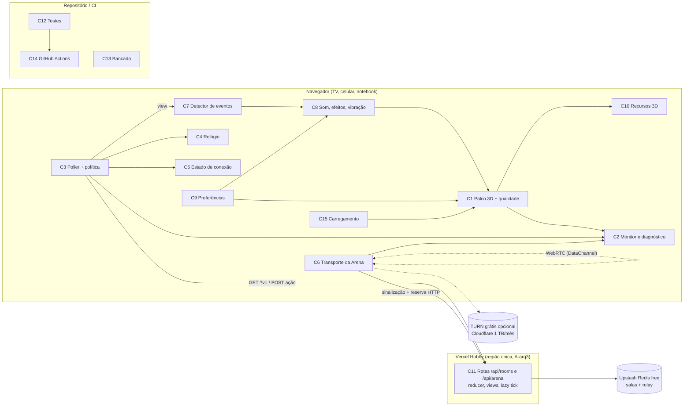

# Arquitetura

## Visão geral
A arquitetura atual continua: Next.js 16 servindo páginas e rotas serverless na Vercel, estado das salas no Upstash Redis com compare-and-swap, polling condicional nas salas e WebRTC entre os aparelhos na Arena. Nenhuma peça de infraestrutura entra nem sai. O trabalho fica quase todo no cliente, em quatro frentes: (1) um palco 3D único com qualidade adaptativa, pausa de quadros e recursos compartilhados; (2) uma camada de rede do cliente unificada e testável, com política de polling por expectativa de ação, relógio mais preciso e reconexão; (3) eventos de jogo vindos da diferença entre duas views (públicos) e da simulação local do celular (locais), que alimentam som, efeitos e vibração sem rota nova; (4) instrumentação (diagnóstico, bancada, testes, CI) para medir antes e depois. No servidor as mudanças são pequenas: expor `changedAt` na view, permitir entrar depois do lobby como jogador "em espera", avisar quando o anfitrião da Arena sai, deixar o jogador sair da sala no lobby, medir comandos Redis por requisição e responder com mensagem própria quando a cota gratuita acabar.

## Stack
| Camada | Escolha | Por quê | Alternativa descartada |
|---|---|---|---|
| Framework web | Next.js 16 (App Router, Turbopack), React 19, TypeScript, Tailwind 4 (sem mudança) | Já em uso; `next/dynamic` já separa o código de cada jogo (RNF3) | Trocar de framework: custo alto e nenhum ganho para os objetivos |
| 3D | three.js 0.186 + @react-three/fiber 9 (sem mudança), com utilitários próprios (qualidade, instanciação, pool de efeitos) | O que falta (monitor de desempenho, dpr adaptativo, instâncias) cabe em ~300 linhas próprias, sem dependência nova de execução | `@react-three/drei`: resolveria `PerformanceMonitor`/`Instances`, mas traz muito código que não usamos e muda o estilo do projeto; reavaliar só se a implementação própria passar de 500 linhas |
| Animação | Interpolação própria dentro de `useFrame` (funções de easing em `lib/anim`) e transições CSS para camadas 2D | Sem custo de bundle; CSS não bloqueia o quadro 3D | framer-motion / react-spring: +30–60 kB e um segundo laço de animação disputando o quadro |
| Áudio | Web Audio sintetizado, generalizando `components/arena/rt/sound.ts` para `lib/audio` | Sem arquivos para baixar (RNF3), já funciona na Arena | Howler + arquivos de som: download extra e dependência |
| Rede das salas | Polling condicional (`?v=` → 204), com política por fase/tipo de jogo/expectativa de ação | Único modelo que cabe no serverless gratuito (Q3) | Long-polling/SSE na Vercel: segura a função aberta e consome memória provisionada do Hobby; WebSocket: não suportado sem servidor dedicado (fora do escopo) |
| Rede da Arena | WebRTC DataChannel + reserva HTTP (sem mudança de modelo) | Já é o caminho de menor atraso e custo zero | Servidor de jogo dedicado ou TURN pago (fora do escopo, Q3) |
| Estado | Upstash Redis REST, plano gratuito (500 mil comandos/mês) | Já em uso; CAS em Lua garante concorrência | Vercel KV/Postgres: troca sem ganho |
| Hospedagem | Vercel Hobby, funções numa região fixa junto do Redis | Custo zero; a região colada ao Redis tira uma ida e volta transcontinental de cada poll | Edge runtime: o Redis continua numa região só, então a borda não ajuda e ainda complica o CAS |
| Testes de lógica e rede | Vitest 5 (sem mudança), relógio e `fetch` falsos (`vi.useFakeTimers`, stubs) | Já em uso; os módulos de rede passam a receber `fetch`/timers injetáveis | — |
| Testes de tela | `jsdom` + `@testing-library/react` + `@react-three/test-renderer` (dev) | Monta telas e cenas sem GPU (K4); premissa A6 aceita deps de dev | Playwright com GPU por software no CI: lento e instável |
| Ponta a ponta | Vitest chamando os handlers das rotas (`GET`/`POST` exportados) com store em memória e N clientes simulados | Exercita reducer, views, CAS e polling sem navegador nem rede; roda em segundos | Playwright com 4 navegadores: caro e frágil para o CI |
| Bancada de desempenho | Página `/bench` com cenas fixas + roteiro manual no aparelho de referência; Playwright (dev, opcional, local) para repetir no desktop com CPU limitada | O aparelho real é a medida que vale (A2); o script dá regressão rápida | Lighthouse: não mede quadros durante jogo |
| CI | GitHub Actions (lint, typecheck, test, build) | Gratuito para o repositório; resolve "sem CI" (A-arq4) | Só os checks de build da Vercel: não rodam testes |

## Componentes
- **C1 Palco 3D e gestor de qualidade** (`components/three/Stage3D.tsx`, novo `lib/three/quality.ts`). Todo `<Canvas>` do projeto passa por `Stage3D`, inclusive o da Arena (`MatchScreen` deixa de criar o próprio). Recebe `active: boolean` (cena com movimento ou parada) e lê o nível de qualidade do contexto `QualityProvider`. Níveis: `alto` (dpr ≤ 1,75, sombra 1024, antisserrilhado), `médio` (dpr ≤ 1,25, sombra 512, antisserrilhado), `baixo` (dpr 1, sem sombra, sem antisserrilhado, efeitos mínimos, `powerPreference: 'default'`). Controlador automático (pseudocódigo): a cada janela de 2 s calcula mediana de fps e p95 do tempo de quadro; duas janelas ruins seguidas (mediana < 50 ou p95 > 33 ms) descem um degrau (primeiro dpr em passos de 0,25, depois sombra, depois efeitos); 10 s acima de 58 fps sobem um degrau, no máximo uma subida a cada 30 s, e nunca sobem de novo depois de oscilar duas vezes. O antisserrilhado só muda na criação do contexto, então o nível inicial vem do último nível aprendido no aparelho (C9) ou de uma heurística (núcleos, `deviceMemory`, tamanho de tela). A troca de sombra só acontece em troca de fase, para esconder a recompilação de shaders (KT2). Como a sombra fica em dois lugares, o nível chega a ambos: o `shadows` do `<Canvas>` liga ou desliga tudo (nível baixo), e o tamanho do mapa vem de um hook `useShadowMapSize()` (1024 / 512 / 0) lido pelo `QualityProvider`. Esse hook é usado por `Lights` (`Stage3D.tsx`, hoje `shadow-mapSize={[1024, 1024]}` fixo) e por toda luz própria de jogo que define `shadow-mapSize` (hoje `Board3D.tsx` l. 167). Ao mudar o tamanho, a luz descarta o `shadow.map` antigo para o three recriar. Os `castShadow` de malhas (~60 usos em 20 arquivos) não mudam. Luzes de jogo com `castShadow` sem tamanho explícito ficam no padrão do three (512) em alto e médio e se desligam no baixo. `frameloop` = `always` quando `active`, `demand` quando parado; animações ambientes de cena parada rodam por `invalidate()` limitado a 20 fps, ou congelam no nível baixo ou com "reduzir movimento". Também detecta WebGL ausente e `webglcontextlost` e mostra mensagem. Atende RF1, RF2, RF4, RF11, RNF1, RNF6, RNF8.
- **C2 Monitor de desempenho e diagnóstico** (`lib/perf/probe.ts`, `components/DiagOverlay.tsx`). Uma sonda dentro do Canvas registra o tempo de cada quadro num buffer circular; a rede (C3, C6) registra RTT, latência de mudança, requisições por minuto e, na Arena, rota, RTT e retratos atrasados. Ativado por `?diag=1` ou pelo ajuste "Diagnóstico" (C9). Mostra fps, tempo de quadro (mediana e p95), latência da sala (p95, rotulada com o papel do aparelho: `tv`, `turn` = celular da vez, `other` = demais celulares, as duas faixas de O2/RF5), requisições/min, `renderer.info.memory` (geometrias e texturas), heap JS quando disponível e o aviso "modo economia" quando ativo (D14). Botão "Gravar 60 s" exporta JSON no formato da bancada (C13). O relatório exportado ou copiado (S10) **não** leva o código da sala, tokens nem apelidos: só papel do aparelho, cena, métricas e versão (o código dá acesso de espectador, JS6). Atende RF3, RF18, RNF2, e O1 a O3 na parte de medição.
- **C3 Laço de sincronização (poller) e política de polling** (`lib/net/poller.ts`, `lib/net/pollPolicy.ts`; `useRoom` e `useArena` passam a usar o mesmo laço). O poller é uma classe sem React que recebe `fetch` e timers injetáveis, e por isso pode ser testada; ele trata 204, descarte de resposta fora de ordem, backoff e aba oculta. A política é uma função pura `nextDelay(ctx) → ms`, com `ctx = { phase, gameKind, role, expectingOthers, msSinceChange, nextDeadline, hidden, failures, economy }` e `role ∈ tv | turn | next | other` (o papel do aparelho é o mesmo que rotula as duas faixas de O2/RF5):
  - **quente (300 ms)**, faixa O2 de p95 ≤ 600 ms: todos os aparelhos em duelo, quiz e minigame por turnos (igual a hoje); a TV em desafio simultâneo, em votação aberta e nas fases do tabuleiro; no tabuleiro, o celular **da vez** (`turn`) e o do **próximo** (`next`, que vira "da vez" na troca de turno e precisa ver isso dentro de 600 ms);
  - **morno (900 ms)**, faixa O2 de p95 ≤ 1,2 s (sujeita a Q10): celular num desafio simultâneo (o jogo roda no próprio aparelho e só o placar alheio chega pela rede, ver A-arq1); demais celulares (`other`) no tabuleiro e na votação (cada um vê a própria ação pela resposta do POST); fases de intro/resultado. Conta: atraso ≈ espera uniforme em [0, 900 ms] + RTT, p95 ≈ 855 ms + RTT ≈ 1,0–1,1 s. Se o `netbench` mostrar p95 > 1,2 s nesse grupo, o morno cai para 750 ms (ajuste de uma constante; custo ≈ +1,6 mil comandos por festa, ainda dentro de RNF4, ver "Orçamento de cota");
  - **frio (1,5 a 3 s)**: lobby sem ação pendente e fim de jogo;
  - **alinhado ao prazo**: se `nextDeadline` cai antes do próximo poll, agenda para `deadline + 50 ms`, porque é ali que o lazy tick muda o estado;
  - **oculto**: **nenhuma requisição**, como hoje (`useRoom.ts` l. 78–81, `lib/arena/net.ts` l. 187–189). O poller só arma um timer local de 1 s que volta a checar `document.hidden` (ou espera `visibilitychange`); ao voltar a ficar visível, faz um poll imediato (C5). `nextDelay` devolve `null` para "não consultar" quando `hidden`;
  - **modo economia** (D14, JD2): dois gatilhos. (1) Global: a variável de ambiente `NEXT_PUBLIC_PD_ECONOMY=1`, ligada pelo mantenedor quando o alerta de cota dispara (exige redeploy, ~1 min). Nela, quente vira 900 ms, morno 1,5 s e frio 3 s (≈ −55 % de comandos por festa, estimado), e O2 deixa de valer enquanto durar. (2) Local, por aparelho: o poller conta as próprias requisições num minuto deslizante; acima de `NEXT_PUBLIC_PD_MAX_REQ_MIN` (padrão 240/min; o quente dá 200/min), a política cai para frio por 60 s. Isso pega laço descontrolado ou bug de política, que nenhuma festa normal atinge. Nos dois casos o diagnóstico (C2) mostra "modo economia".
  O próprio aparelho continua aplicando na hora a view devolvida pelo POST da ação. A tabela `lib/game/cadence.ts` (id do minigame → `duel | turns | solo | quiz`) é pública e não importa código de servidor. Atende RF5, RNF4, O2.
- **C4 Relógio do servidor** (`lib/net/clock.ts`). Passa a estimar a diferença de relógio a cada resposta como `serverNow − (t0 + t1)/2`, com `t0`/`t1` medidos por `performance.now()`. Guarda a amostra de menor RTT dos últimos 30 s, troca o limiar fixo de 400 ms por um filtro de menor RTT e expõe `serverTime()` para C2 medir a latência de mudança (`agora corrigido − view.changedAt`). A API pública (`useServerClock`, `useCountdown`) não muda. Atende RF3, RF14, RF18.
- **C5 Estado de conexão e reconexão** (`lib/net/connection.ts`, `components/ConnectionBadge.tsx`). Máquina de estados `ok → lento → reconectando → sem rede`, alimentada pelo poller (falhas, RTT) e pelos eventos `online`/`offline`/`visibilitychange`. Ao voltar `online` ou visível, força um poll imediato. O teto de backoff cai de 8 s para 4 s. A sessão já fica no `localStorage`, então o estado volta sem recarregar a página. Atende RF6.
- **C6 Transporte da Arena** (`lib/arena/rt/link.ts`, `useRt.ts`, `runtime.ts`). Mudanças:
  - (a) o retrato é serializado uma vez por tick e a mesma string vai para todos os pares, em vez de um `JSON.stringify` por par;
  - (b) o limite de fila do canal rápido cai de 64 kB para ~16 kB, para descartar retrato velho em vez de acumular atraso;
  - (c) a reconexão direta continua em segundo plano enquanto se joga pela reserva (backoff até 15 s, sem o limite atual de 3 tentativas) e reinicia em `online`/`visibilitychange`;
  - (d) a presença do anfitrião: o anfitrião manda `navigator.sendBeacon` com a ação `host_left` em `pagehide`. O corpo vai como string (`sendBeacon(url, JSON.stringify({ action, auth }))`), que o navegador envia como `text/plain;charset=UTF-8`, um tipo que nunca dispara preflight nem é recusado pelo `sendBeacon`. A rota lê o corpo por `readJson` (`req.json()`, `lib/api.ts` l. 65), que já ignora o `Content-Type`, então aceita `text/plain` e `application/json` igualmente (JV6). Como `pagehide` também dispara em recarga, navegação e entrada no bfcache, o beacon só **marca** a saída (`hostLeftAt`) e não encerra nada. A mensagem S12 ("o anfitrião saiu", com o botão "Voltar à sala") só aparece depois de uma carência:
    - pelo servidor: a view da Arena expõe `hostAway: boolean`, calculado no servidor como `hostLeftAt != null && now − hostLeftAt ≥ 10 s`. Assim o cliente não depende do próprio relógio;
    - pelo cliente, sem beacon (KT11): 15 s seguidos sem retrato pelo canal direto nem pela reserva **e** sem nenhuma mudança da sala vinda do anfitrião.
    Qualquer requisição autenticada do anfitrião (poll `GET /api/arena/:code`, ação, `rt`) limpa `hostLeftAt` (C11d). Uma recarga comum, que volta a consultar em poucos segundos, nunca chega a S12. Se `hostAway` voltar a `false`, a mensagem some sozinha;
  - (e) medição de retrato atrasado no `SnapBuffer`: atraso = (chegada − chegada de referência) − (tick − tick de referência) × 1/60 s, com a referência no menor atraso observado.
  Atende RF6, RF10, O3, RF14.
- **C7 Fontes de eventos de jogo** (`lib/game/events.ts` e `lib/game/eventBus.ts`, client-safe). Duas fontes publicam no mesmo barramento, que C8 assina:
  - **públicos** (vistos na TV e em todos os aparelhos): função pura `diffEvents(prev: RoomView, next: RoomView, me?) → GameEvent[]`. Tipos: `dice`, `move`, `point`, `miss`, `turnEnd`, `phase`, `win`, `lose`, `join`, `coins`, `star`, além dos de placar dos minigames. Usa só o que a view já expõe, então não cria ação, rota nem requisição nova e não mexe em `KNOWN` (salas, `app/api/rooms/[code]/action/route.ts`) nem em `ARENA_ACTIONS` (Arena, `lib/arena/room.ts`);
  - **locais** (só no celular que joga): nos desafios simultâneos a simulação roda no próprio aparelho, e a TV só recebe o placar (A-arq1). Eventos como "aro" no Basquete (o `BasketController` só envia `made`/`fire` em `progress`), "bate no obstáculo" no Minigolfe, "batida" na Corrida e "perdeu vida" no Fantasma não existem na view. O controlador local chama `emitLocal({ type, game, ... })` no momento em que a simulação detecta o fato. Nada vai para a rede.
  Cada `GameEvent` leva `origin: 'public' | 'local'`. A tabela por minigame em `events.ts` (a "lista de eventos por jogo" de O5/S7) declara, para cada evento, a origem: `public` quando é derivável da view (pontos, acertos e erros que mudam o placar, fim, vitória) e `local` quando nasce da simulação no celular. Regra para classificar: se o fato não altera nenhum campo da view filtrada, ele é `local`. Teste: eventos `public` saem de `diffEvents` sobre fixtures; eventos `local` são testados no controlador com entrada sintética (seed fixa), verificando que `emitLocal` é chamado. Na TV, os eventos `local` dos celulares não aparecem; a TV reage só ao placar (ex.: "ponto" em vez de "aro"). Na Arena o equivalente já existe (`SoundId` no retrato) e é reaproveitado como fonte pública. Atende RF7, RF8, RF12, O5.
- **C8 Retorno: som, efeitos e vibração** (`lib/audio` generalizando `sound.ts`; `components/three/FxLayer.tsx`; `components/PhaseTransition.tsx`; `lib/haptics.ts`). Assina os eventos de C7. Som por síntese Web Audio, liberado no primeiro toque, com mudo persistente. Efeitos 3D num único pool de partículas por Canvas (`InstancedMesh`, quantidade conforme o nível de qualidade; com "reduzir movimento" vira só um clarão). Transições de fase em camada DOM com CSS (intro → jogo → resultado) somadas ao movimento de câmera que já existe (`CameraTo`). Vibração via `navigator.vibrate` quando houver suporte. Atende RF7, RF8, RF11, RF12, RNF7.
- **C9 Preferências do aparelho** (`lib/prefs.ts`, reaproveitando o `localStore` de `lib/arena/net.ts`). Chave `partydeck:prefs:v1` = `{ quality: 'auto' | 'performance', muted, haptics, diag, reducedMotion: 'system' | 'on' | 'off' }` e `partydeck:quality:v1` = último nível aprendido. Painel de ajustes reaproveita `HostSettings`/menu existente. Atende RF2, RF7, RF11, RF12.
- **C10 Recursos 3D compartilhados** (`lib/three/assets.ts`, `lib/three/useDisposable.ts`). Geometrias e materiais comuns (moeda, casa do tabuleiro, peão, bola, partícula) ficam em cache no módulo e são reutilizados entre jogos e montagens. Objetos criados à mão com `new THREE.*` em `useMemo` passam por `useDisposable`, que libera na desmontagem. Repetições (casas do tabuleiro, moedas, galinhas, células da batalha naval, partículas) viram `InstancedMesh`. Atende RNF1, RNF2, O1.
- **C11 Servidor de salas** (`lib/game/reducer.ts`, `views.ts`, `app/api/...`, `lib/arena/room.ts`). Mudanças:
  - (a) `toView` passa a expor `changedAt` (o `updatedAt` do estado);
  - (b) as rotas respondem com o cabeçalho `Server-Timing` (`redis;dur`, `total;dur`, `cmd;desc=<n>` com o número de comandos Redis da requisição, contado em `command()` de `lib/store/redis.ts`, e `cold;desc=1` na primeira requisição de cada instância, detectada por uma variável de módulo). Os dois últimos alimentam a contagem real de comandos por poll (JD2) e a separação fria/quente do `netbench` (JV4);
  - (c) `addPlayer` aceita entrar depois do lobby com `status: 'waiting'` (ver Modelo de dados), e o reducer promove os jogadores em espera no início do próximo turno do tabuleiro (torneio) ou na próxima partida (partida rápida e modo equipes), com as regras de D11 (limite, valores iniciais, ordem, voto), por um helper único `activePlayers(state)` que os minigames passam a usar;
  - (d) a Arena ganha a ação `host_left`: entra no tipo `ArenaAction` e em `ARENA_ACTIONS` (`lib/arena/room.ts`). Hoje `actorFrom` (`lib/api.ts`) lê o token só dos cabeçalhos `x-pd-role`/`x-pd-token`, e `sendBeacon` não envia cabeçalho próprio. Por isso a rota `app/api/arena/[code]/action` ganha um caminho próprio: se `action.type === 'host_left'` e não houver `x-pd-role`, usa um helper novo `hostFromBody(body.auth, state)` em `lib/api.ts` (mesma comparação `safeEqual`, só aceita `role: 'host'`). Para qualquer outra ação, `body.auth` é ignorado e o cabeçalho continua obrigatório. `host_left` grava `hostLeftAt = now` (idempotente). Na outra ponta, `applyArena` e as rotas `GET /api/arena/:code` e `/rt` limpam `hostLeftAt` quando o ator é o anfitrião e o campo está preenchido. No GET isso custa uma escrita (CAS) só nesse caso raro; o poll normal continua só de leitura;
  - (e) ação `leave` (jogador, entra em `KNOWN` de `app/api/rooms/[code]/action/route.ts`): no lobby ou com `status: 'waiting'`, remove o próprio jogador de `players` e o token de `secrets.playerTokens`, como o `kick` atual faz pelo anfitrião (`reducer.ts` l. 929). Depois que a partida começou, o apelido fica até o fim (ranking e turnos dependem dele) e some com a sala no TTL de 6 h (JS2);
  - (f) cota esgotada: o store (`lib/store/redis.ts`) passa a reconhecer a resposta de limite do Upstash (HTTP de erro com mensagem de limite de comandos ou de banda; o texto exato é conferido ao provocar o erro em teste com store falso) e lança `QuotaError`. `errorResponse` responde `503 { error, reason: 'quota' }`, e o cliente mostra "O limite gratuito deste mês foi atingido. As salas voltam quando a cota renovar." em vez do erro genérico, tanto na criação de sala quanto num poll (JC1). O texto da proposta ("tente amanhã") foi trocado porque a cota do Upstash é mensal, não diária.
  O código de minigame continua só no servidor. Atende RF5 (medição), RF9, RF10, RF19, RNF4, RNF5.
- **C12 Suíte de testes** (`tests/`). Quatro camadas:
  - (1) lógica atual, sem mudança (RNF9);
  - (2) rede do cliente: poller (204, fora de ordem, backoff, aba oculta sem nenhuma requisição e poll imediato ao voltar a ficar visível), política (tabela de casos por papel `tv`/`turn`/`next`/`other`, que fixa 300 ms nos papéis da faixa de 600 ms e ≤ 900 ms nos demais; modo economia global e local; e um teste de orçamento que simula uma festa de 8 pessoas e compara as requisições por minuto com a política atual), relógio (diferença de relógio com RTT assimétrico) e troca de transporte da Arena (`RtcClient`/`RelayClient` com `RTCPeerConnection` falso);
  - (3) telas: para cada entrada de `SCREENS` e para tabuleiro, `HostScreen`, `/play` e `MatchScreen`, montagem em jsdom com `Stage3D` trocado em teste por um palco que monta os filhos no `@react-three/test-renderer`, avança 10 quadros e falha se houver erro; as views vêm dos fixtures;
  - (4) ponta a ponta: cria sala, entra 3 jogadores, joga um minigame até o resultado chamando os handlers das rotas, valida que nenhum cliente recebe `secrets`/`seed`/gabarito e grava a sequência de views como fixture. Casos de rota acrescentados nesta revisão: `host_left` com `Content-Type: text/plain` e com `application/json` gravam `hostLeftAt` (JV6); store falso que devolve erro de cota → `503 reason: 'quota'` (JC1); `leave` no lobby remove o jogador e o token, e depois do lobby é recusado (JS2); `/bench` responde 404 sem `PD_BENCH=1` (JS6); o relatório do diagnóstico não contém o código da sala (JS6).
  Inclui ainda um teste de inventário: a lista de ids de minigames, de `SCREENS` e de esportes da Arena é comparada com uma lista fixa, então adicionar jogo exige mudar o teste conscientemente. Atende RF14, RF15, RF16, RF19, RNF5, RNF9.
- **C13 Bancada de desempenho** (`app/bench/page.tsx`, `docs/bench/`, `scripts/bench.mjs`, `scripts/netbench.mjs`). `/bench?cena=<id>&s=60` monta uma cena com fixtures (views geradas pelo reducer real, já filtradas) e entrada sintética repetível (`seed` fixa) e devolve o JSON de C2. Cenas: tabuleiro, cada minigame (TV e celular) e Arena em modo treino. `netbench` roda N clientes Node e mede, **por papel** (`tv`, `turn`, `other`), o p95 da latência de mudança, as requisições/min e os comandos Redis (soma de `cmd` do `Server-Timing`) por festa simulada. Cada resposta é classificada como **fria** (`cold;desc=1` no `Server-Timing`) ou **quente**, e o JSON traz `p95_frio` e `p95_quente` além do p95 total (JV4). Se `p95_frio` passar de 600 ms, avalia-se um ping leve (`GET /api/ping`, sem Redis) na entrada da sala e na troca de fase; o ping custa só invocações Vercel. Alvo do `netbench` (JD2): por padrão, `next start` local com store em memória (zero cota); para rede real, um preview ligado a um **banco Upstash separado** de medição, nunca o Redis de produção (ver "Ambientes"). Os resultados de linha de base e de cada mudança ficam em `docs/bench/AAAA-MM-DD-<cena>.json`. O roteiro manual no aparelho de referência fica em `docs/bench/ROTEIRO.md`. A página é ferramenta de medição, não modo de jogo, e não aparece em nenhum menu (A-arq6). Ela só existe quando `PD_BENCH=1` (variável de servidor, ligada no preview e desligada em produção); sem a variável, `/bench` responde 404 (`notFound()`), e o código das cenas de bancada não entra no caminho das páginas de jogo (JS6). Atende RF17, RF18, RNF1, RNF2, RNF3, RNF8.
- **C14 CI** (`.github/workflows/ci.yml`). Em cada push e PR roda `npm ci`, lint, typecheck, test e build, em Node 22 com cache de npm. Atende O4, RNF9.
- **C15 Carregamento** (`components/minigames/registry.tsx`, `components/three/Loading3D.tsx`). Troca o "Carregando 3D…" por um esqueleto com progresso em etapas (código → cena → primeiro quadro). Faz `import()` antecipado do código do próximo jogo durante `vote_results`/`minigame_intro`, o que já se sabe pela view. O código continua separado por jogo. Atende RF13, RNF3.

## Modelo de dados
| Entidade | Onde vive | Campos principais (novos em **negrito**) | Relações |
|---|---|---|---|
| `GameState` (sala da festa) | Redis `partydeck:room:<code>`, TTL 6 h | `version`, `updatedAt`, `phase`, `players[]`, `order[]`, `minigame`, `secrets`, `seed`... | 1 sala → N jogadores, 0..1 minigame ativo |
| `Player` | dentro de `GameState` | `id`, `name`, `team`, `lastSeen`, **`status?: 'active' \| 'waiting'`** (ausente = `active`, compatível com salas já gravadas) | jogador em espera fica fora de `order` e dos minigames até ser promovido |
| `RoomView` | resposta HTTP (derivada) | campos atuais + **`changedAt`** (servidor, ms) + **`me.status`** | gerada por `toView` por público; nunca contém `secrets` |
| `ArenaState` (sala da Arena) | Redis (prefixo da Arena), TTL 6 h | campos atuais + **`hostLeftAt?: number`** (gravado por `host_left`, limpo por qualquer requisição autenticada do anfitrião); a view expõe só **`hostAway: boolean`** (carência de 10 s) | 1 sala → N partidas RT |
| Relay da Arena | Redis (`lib/store/relay.ts`) | entradas, ações, retrato | sem mudança |
| Snapshot RT | memória do anfitrião → DataChannel | `View` atual (com `tick`) | sem mudança de formato; serialização única por tick |
| Preferências | `localStorage` `partydeck:prefs:v1` | `quality`, `muted`, `haptics`, `diag`, `reducedMotion` | por aparelho |
| Qualidade aprendida | `localStorage` `partydeck:quality:v1` | `tier`, `dpr`, `at` | por aparelho |
| Amostras de diagnóstico | memória do navegador (buffer circular), exportável como JSON | `role`, `frames[]`, `netLatency[]`, `reqPerMin`, `snapLate%`, `mem`, `economy` (sem código de sala, token ou apelido) | não sai do aparelho sem ação do usuário |
| Fixtures de view | `tests/fixtures/views/*.json` (repositório) | sequências de `RoomView` por jogo e público | geradas pelo reducer real; usadas por C12 e C13 |
| Resultados de bancada | `docs/bench/*.json` (repositório) | `{cena, aparelho, data, commit, fpsMed, frameP95, netP95, reqMin}`; no `netbench`, `netP95` por papel (`tv`, `turn`, `other`), `p95_frio`, `p95_quente`, `cmdPorFesta` | comparação antes/depois |

## Integrações e APIs
- **Upstash Redis REST** (sem mudança de comandos): `GET`, `SET NX EX`, `EVAL` (CAS), `DEL`. Autenticação por `Bearer` em variável de ambiente no servidor. Plano gratuito: 500 mil comandos/mês, 10 GB de banda/mês, 256 MB de dados ([Upstash, preços]). Erro de limite vira `QuotaError` → `503 reason: 'quota'` (C11f).
- **TURN gratuito opcional** (sem mudança de código, `/api/arena/ice` já aceita os dois e gera credenciais efêmeras no servidor):

  | Provedor | Teto gratuito (conferir no painel antes de ligar) | Ao estourar | Uso |
  |---|---|---|---|
  | **Cloudflare Realtime TURN** (padrão recomendado) | 1.000 GB/mês, compartilhado com o SFU da Cloudflare ([Cloudflare, preços do Realtime]) | Cobra US$ 0,05/GB acima do teto, o que quebraria o custo zero. Por isso: checagem mensal do painel e, se passar de 50 % (500 GB), apagar as variáveis `CLOUDFLARE_TURN_*` na Vercel. Sem TURN, a Arena cai para a reserva HTTP, que gasta Redis (ver "Orçamento de cota") | Estimativa: um par retransmitido a ~60 kB/s gasta ~0,2 GB/h; 500 GB ≈ 2.300 h-par/mês, muito acima do uso previsto |
  | Metered (alternativa) | A página oficial cita 500 MB/mês no plano gratuito (textos antigos citam 50 GB, e o comentário em `ice/route.ts` diz 50 GB; conferir no painel) | O plano gratuito não cobra excedente; o relé para e a Arena cai para a reserva HTTP | Só se a conta Cloudflare exigir cartão e o dono não quiser cadastrar |
- **Contratos alterados** (o restante segue igual):
  - `GET /api/rooms/:code?v=<n>` → `204` (sem mudança) | `200 RoomView` com `changedAt` | `503 { error, reason: 'quota' }` com cota esgotada. Cabeçalho `Server-Timing: redis;dur=<ms>, total;dur=<ms>, cmd;desc=<n>[, cold;desc=1]` nas respostas 204 e 200. `POST /api/rooms` (criar sala) também pode responder `503 reason: 'quota'`.
  - `POST /api/rooms/:code/action` `{ action: { type: 'leave' } }` (jogador) → `200 RoomView` no lobby ou em espera; `409` depois que a partida começou.
  - `POST /api/rooms/:code/join` `{ name }` → `200 { playerId, playerToken, status: 'active' | 'waiting' }`. Antes do lobby, `active`. Depois, `waiting`. `409 { error, reason }` com **`reason: 'full' | 'name_taken'`**: `full` quando `players.length ≥ MAX_PLAYERS` (jogadores em espera contam, D11) e `name_taken` quando o nome se repete. O cliente decide pelo `reason`, nunca pelo texto de `error`. Com `full`, o cliente oferece assistir por `/tv?c=`. O 409 "a partida já começou" de hoje deixa de existir, porque depois do lobby a entrada vira `waiting`. Para isso, `RuleError` ganha um campo opcional `reason`, que `errorResponse` (`lib/api.ts`) inclui no JSON quando presente. No modo equipes, entra em espera até a próxima partida (A-arq5).
  - `POST /api/arena/:code/action` `{ action: { type: 'host_left' }, auth: { role: 'host', token } }` (via `sendBeacon`, sem cabeçalhos `x-pd-*`, corpo `text/plain;charset=UTF-8`; `application/json` também é aceito) → `204`. Grava `hostLeftAt`. O token é comparado em tempo constante. `auth` no corpo só é aceito para `host_left`; nas outras ações → `401` se faltar o cabeçalho, como hoje.
  - `GET /api/arena/:code` → view da Arena com **`hostAway: boolean`**. Quando o ator é o anfitrião, limpa `hostLeftAt`.
- **APIs do navegador**: WebGL, Web Audio, `navigator.vibrate`, `matchMedia('(prefers-reduced-motion)')`, `performance.now`, `navigator.sendBeacon`, `RTCPeerConnection`. Sempre com detecção de suporte e degradação silenciosa, exceto WebGL, que mostra mensagem (RNF6).

## Segurança e privacidade
- Autenticação e autorização não mudam: tokens no cabeçalho, comparação em tempo constante, ação autorizada por papel. O jogador em espera recebe token de jogador, mas o reducer rejeita as ações de jogo dele até a promoção, por uma regra única em `activePlayers`.
- RNF5: `changedAt` e `status` são públicos por natureza. O detector de eventos (C7) roda só sobre views já filtradas. Os fixtures são views (nunca `GameState`) e têm teste que falha se aparecer `secrets`, `seed`, gabarito ou frota. O teste de ponta a ponta verifica o mesmo em cada resposta. A regra "nada de minigame do servidor no cliente" continua valendo, e `cadence.ts`/`events.ts` ficam em arquivos client-safe.
- `host_left` por `sendBeacon` leva o token no corpo (`auth`), aceito só para essa ação e só com papel de anfitrião. O token vai no corpo, nunca na URL. O pior caso de abuso é marcar como ausente o anfitrião de uma sala da qual o atacante já tem o token; a próxima requisição do anfitrião real desfaz a marca.
- Segredos (Redis, TURN) continuam só no servidor, em variáveis de ambiente da Vercel. O CI não precisa de nenhum segredo (testes usam o store em memória).
- Privacidade/LGPD (JS2):
  - **dados tratados**: o apelido (dado pessoal quando identifica alguém) e, indiretamente, o IP nos logs de função da Vercel. Não há cadastro, e-mail, senha, localização nem telemetria remota nova. Diagnóstico e preferências ficam no aparelho;
  - **finalidade**: identificar o jogador dentro da sala durante a partida (placar, vez, ranking). Nada é usado para outro fim nem compartilhado;
  - **base legal** (A-arq7): execução de contrato ou de procedimentos preliminares a pedido do titular [LGPD art. 7º, V], porque o apelido é o mínimo para prestar o jogo que a pessoa pediu para entrar. Para crianças e adolescentes, vale o melhor interesse [LGPD art. 14], e o apelido livre (não precisa ser nome real) reduz o dado ao mínimo [LGPD art. 6º, III];
  - **retenção**: o estado da sala, com apelidos e tokens, vive só no Redis com TTL de 6 h a partir da última gravação. Não há cópia, backup nem log com apelido;
  - **como apagar**: no lobby ou em espera, "Sair da sala" (ação `leave`, C11e) remove o apelido e o token na hora; o anfitrião também pode remover no lobby (`kick`). Depois que a partida começa, o apelido fica até a sala expirar (no máximo 6 h), porque o ranking depende dele. O aviso diz isso;
  - **aviso ao titular**: um texto curto nas telas de entrada (S1 criar sala e S2 entrar), abaixo do campo de apelido: "Use um apelido, não seu nome completo. Ele aparece para quem está na sala e é apagado em até 6 h. Menores de idade: jogue com um responsável." O designer define a forma; o teste de montagem confere que o texto existe;
  - se o projeto virar serviço público com operador identificável (pessoa jurídica ou uso comercial), consultar profissional jurídico sobre base legal, aviso e registro de operações.
- Relatório de diagnóstico e bancada (JS6): o relatório copiado (S10) não contém o código da sala, tokens nem apelidos (C2). A página `/bench` só existe com `PD_BENCH=1` e responde 404 em produção (C13, D15).
- Resposta a incidente e logs: ver "Infraestrutura e operação" (JS4).

## Infraestrutura e operação
- **Hospedagem**: Vercel Hobby e Upstash gratuito, com a região das funções fixada (`vercel.json` → `regions`) na mesma região do banco Upstash (ex.: `gru1` + `sa-east-1`, A-arq3).
- **Ambientes** (JD2): local (store em memória; alvo padrão do `netbench`), preview da Vercel e produção. O preview usa um **segundo banco Upstash gratuito**, só para preview e medição, com variáveis `UPSTASH_REDIS_REST_*` separadas por ambiente na Vercel; assim medições e testes de festa não gastam a cota de produção. Se a conta do Upstash não permitir um segundo banco gratuito (conferir no painel; não está na base normativa), o preview usa o banco de produção, mas as medições de rede rodam contra `next start` local com store em memória, e as rodadas em rede real (T14/T16/T44) ficam limitadas a 3 min cada, com os comandos gastos registrados (soma de `cmd`).
- **Deploy**: o fluxo atual da Vercel no push. O CI (C14) roda antes e precisa passar para o merge.
- **Observabilidade**: `Server-Timing` visível no DevTools e no diagnóstico (C2), logs de função da Vercel, painel do Upstash (comandos e banda do mês). Sem APM pago.
- **Alertas de cota e rotina** (JC1): (a) alerta de uso do Upstash a 60 % e 80 % da cota mensal de comandos e de banda, por e-mail do painel do Upstash se o plano gratuito oferecer; se não oferecer, a checagem semanal abaixo é o único alerta e isso fica dito no README; (b) rotina do mantenedor, toda segunda-feira, ~2 min: abrir o painel do Upstash (comandos e banda do mês), da Vercel (invocações, CPU ativa, banda) e da Cloudflare TURN (GB do mês), e anotar os números num quadro do README; (c) ao passar de 80 % antes do dia 20 do ciclo, ligar o modo economia global (`NEXT_PUBLIC_PD_ECONOMY=1`, D14) até a cota renovar; (d) cota esgotada: as rotas respondem `503 reason: 'quota'` e as telas mostram a mensagem de C11f, nunca o erro genérico; (e) o `netbench` imprime comandos Redis por festa simulada, e o README traz o número medido e o teto de festas/mês que ele implica.
- **Backup**: não se aplica. As salas são efêmeras, e os atletas salvos ficam no `localStorage` do jogador.
- **Orçamento de cota** (estimativa; os comandos por poll são medidos por `cmd` do `Server-Timing` numa festa-teste no banco de preview antes de fechar, JD2). Hoje uma festa de 8 jogadores + TV, torneio de 10 turnos (~15 min de minigame), gasta ~30 req/s × 900 s ≈ 27 mil polls em minigame + ~8 mil nas outras fases, ou ~35 mil comandos Redis (1 `GET` por poll, `lib/store/redis.ts` l. 94, mais o CAS das ações). Compensação da política C3 (D4), **sem contar abas ocultas**, que já não fazem requisição hoje e continuam sem fazer:
    - economia: nos desafios simultâneos (5 de 13 jogos, ~38 % de ~900 s ≈ 340 s), os 8 celulares passam de 300 ms para 900 ms; o total cai de 30 para ~12,2 req/s (TV 3,3 + celulares 8,9), uma economia de ~17,8 req/s × 340 s ≈ **−6,0 mil**;
    - gasto extra: nas fases do tabuleiro (~600 s dos ~800 s fora de minigame), a TV, o celular da vez e o do próximo sobem de 900 ms para 300 ms; o total vai de 10 para ~16,7 req/s (3 × 3,3 + 6 × 1,1), um gasto de ~6,7 req/s × 600 s ≈ **+4,0 mil**. Na votação (~60 s), só a TV fica quente: ≈ **+0,1 mil**;
    - saldo: ~35 mil → ~33,1 mil por festa (≈ −5 %), dentro de RNF4. Se o morno precisar cair para 750 ms (C3), ~34,7 mil, ainda dentro. Se todos os celulares ficassem quentes no tabuleiro, o gasto seria de ~+12 mil e RNF4 seria violado; por isso os demais celulares ficam na faixa de 1,2 s de O2 (Q10, A-arq1).
  Meta: requisições/min por jogador ≤ hoje (RNF4), verificada pelo teste de orçamento (C12) e pelo `netbench`.

  **Cenários mensais** (JC2). Premissas: festa como acima, ~33 mil comandos e ~33 mil invocações Vercel; ~8 usuários por festa, cada um em 1 festa/mês; banda Vercel ≈ 33 mil respostas × ~5 kB + ~3 MB de código por aparelho ≈ 0,2 GB/festa; banda Upstash ≈ 33 mil `GET` × estado de ~10 kB ≈ 0,33 GB/festa (o tamanho real do estado é medido em T14). Tetos gratuitos: Upstash 500 mil comandos e 10 GB/mês; Vercel Hobby 1 milhão de invocações e 100 GB de banda/mês, além de CPU ativa e memória provisionada, que só o painel mede (conferir os números atuais nas páginas oficiais).

  | Cenário | Festas/mês | Comandos Redis (% de 500 mil) | Banda Upstash (% de 10 GB) | Invocações Vercel (% de 1 M) | Banda Vercel (% de 100 GB) | Cabe no gratuito? |
  |---|---|---|---|---|---|---|
  | Protótipo (1 festa/semana) | ~4,3 | ~142 mil (28 %) | ~1,4 GB (14 %) | ~142 mil (14 %) | ~0,9 GB (1 %) | Sim, com folga para medições e Arena |
  | 100 usuários/mês | ~13 | ~430 mil (86 %) | ~4,3 GB (43 %) | ~430 mil (43 %) | ~2,6 GB (3 %) | No limite: passa do gatilho de 80 % e não sobra cota para Arena na reserva nem para medições no banco de produção |
  | 10 mil usuários/mês | ~1.250 | ~41 milhões (≈ 83×) | ~410 GB (≈ 41×) | ~41 milhões (≈ 41×) | ~250 GB (2,5×) | Não. Estoura Upstash e Vercel; o Hobby também é só para uso não comercial |
  | Arena, por minuto de partida com 4 jogadores | — | direto (WebRTC): ~0 por tick, só sinalização (algumas dezenas por partida); reserva HTTP: ~10 req/s por jogador × ~2,5 comandos por requisição (`GET` da sala + `HSET`/`EXPIRE` ou `GET` do retrato, `rt/route.ts`) ≈ **~6 mil comandos/min** | reserva: retrato de até 24 kB por `GET` | reserva: ~2,4 mil invocações/min | — | Direto, sim. Uma hora de partida toda na reserva gasta ~360 mil comandos (~72 % da cota). O número real sai de T14 e vai para `docs/bench` |

  **Ponto de ruptura**: a cota de comandos do Upstash é o primeiro limite, em ~15 festas/mês (~120 usuários/mês) sem Arena na reserva; a banda do Upstash vem depois (~30 festas, ou antes se o estado medido for maior que 10 kB, KT12); as invocações Vercel, em ~30 festas. **Gatilho de decisão**: uso ≥ 80 % da cota de comandos ou de banda do Upstash em 2 meses seguidos, ou cota esgotada uma vez. **Alternativas gratuitas avaliadas, nesta ordem**: (1) modo economia global (D14), ~−55 % de comandos por festa, ao custo de O2 no período; (2) banco separado para preview e medição (já previsto em "Ambientes"), que tira as medições da cota de produção; (3) na reserva da Arena, trocar o `GET` da sala por requisição por uma verificação mais barata, como uma chave curta da partida com TTL, o que dá ~−40 % na reserva (mudança de servidor, só se a medição mostrar a reserva como maior consumidor); (4) TURN ligado (Cloudflare), que tira jogadores da reserva. **Plano B pago mais barato** (só registrado; Q3 exige custo zero, e a decisão é do usuário): Upstash pay-as-you-go, US$ 0,20 por 100 mil comandos (≈ US$ 1–2/mês no cenário de 100 usuários; ≈ US$ 80/mês no de 10 mil) e, no cenário de 10 mil, Vercel Pro (~US$ 20/mês por membro).
- **Resposta a incidente** (JS4). Responsável: o mantenedor do repositório (dono do projeto na Vercel e no Upstash), que decide sozinho e registra. Roteiro:
  1. **detectar**: token do Upstash ou da TURN exposto (commit, log, print), ou acesso estranho no painel;
  2. **conter** (≤ 1 h): no painel do Upstash, gerar um novo token REST (reset do token/senha do banco), atualizar `UPSTASH_REDIS_REST_TOKEN` (ou `KV_REST_API_TOKEN`) na Vercel e fazer redeploy; fazer o mesmo com `CLOUDFLARE_TURN_API_TOKEN`/`METERED_TURN_API_KEY`, se expostos;
  3. **revogar tokens de jogo**: os tokens de anfitrião e de jogador vivem só no estado da sala, então `FLUSHDB` no banco afetado (pelo console do Upstash) invalida todos de uma vez. Custo: as salas abertas acabam, o que é aceitável (são efêmeras);
  4. **avaliar e comunicar**: se houve acesso a dados pessoais com risco ou dano relevante aos titulares, comunicar a ANPD e os titulares em até 3 dias úteis [Resolução CD/ANPD nº 15/2024]. Na prática, os únicos dados são apelidos com no máximo 6 h de vida, o que torna esse caso improvável, mas a avaliação fica registrada;
  5. **registrar**: data, causa, o que foi feito, num arquivo de incidentes do repositório.
  **Logs**: os logs de função da Vercel ficam como são, com a retenção do plano Hobby. O projeto não cria log novo com IP, apelido ou token, e o `console.error` atual (ex.: `ice/route.ts`) não registra dado pessoal. Se o mantenedor operar o projeto como pessoa jurídica com fins econômicos, conferir o dever de guarda de registros de acesso a aplicação por 6 meses [Marco Civil da Internet, art. 15], que o plano Hobby não cobre sozinho. O documento `docs/SEGURANCA.md` de 1 página com esse roteiro fica a cargo do planejador (tarefa no 04).
- **Custo estimado**: R$ 0 nos cenários "protótipo" e "100 usuários/mês" (planos gratuitos da Vercel, do Upstash, do GitHub Actions e da TURN Cloudflare dentro de 1 TB). Acima disso, ver o plano B.

## Decisões (ADRs curtas)
- **D1: Manter a stack e não adicionar dependência de execução.** Contexto: Q3 (custo zero), o "Contexto existente" e a regra de preferir o que existe. Consequências: utilitários próprios para qualidade, animação, instâncias e áudio. Dependências novas só de desenvolvimento (A6).
- **D2: Qualidade adaptativa própria em três níveis, com histerese, nível aprendido por aparelho e antisserrilhado fixo por sessão.** Contexto: RF1/RF2 e o fato de que hoje tudo liga sombra, AA e dpr alto. Consequências: um único ponto (`Stage3D`) controla o custo gráfico, e todo efeito novo consulta o nível (mitiga K1). Exige migrar `MatchScreen` para `Stage3D`.
- **D3: `frameloop="demand"` em cenas paradas, com `invalidate()` limitado para animação ambiente.** Contexto: RF4 e RNF8. Consequências: cada tela declara `active`. Componentes com `useFrame` que precisam rodar numa cena parada chamam `invalidate`. A migração é por tela, protegida pelos testes de montagem (KT1).
- **D4: Polling dirigido por expectativa de ação, alinhado a prazos, em vez de cadência fixa por fase.** Contexto: O2 com 900 ms nas fases do tabuleiro excede a meta, e RNF4 proíbe gastar mais. Consequências: aparece latência menor onde alguém espera, e requisição é poupada onde ninguém espera. A política é função pura e testável com orçamento simulado. A compensação vem só dos celulares em desafio simultâneo (−6,0 mil por festa) contra a TV, o celular da vez e o do próximo quentes no tabuleiro e a TV na votação (+4,1 mil); aba oculta não entra na conta porque já não consulta hoje (ver "Orçamento de cota"). Long-poll/SSE foram descartados por consumirem tempo de função no Hobby.
- **D5: Funções da Vercel na mesma região do Redis.** Contexto: cada poll faz pelo menos uma chamada REST ao Upstash. Consequências: tira dezenas a centenas de ms por poll quando hoje estão em regiões diferentes. Pode exigir recriar o banco gratuito na região certa (as salas são efêmeras, não há migração de dados).
- **D6: Eventos de jogo no cliente, de duas fontes: diferença de views (públicos) e controlador local (locais).** Contexto: RF7/RF8/RF12 precisam de eventos, e criar ações ou campos novos no servidor arrisca RNF4/RNF5 e a lista de ações aceitas. Nos desafios simultâneos, boa parte dos eventos acontece só na simulação do celular e nunca chega à view. Consequências: sem custo de rede. Eventos públicos que acontecem e se desfazem entre dois polls podem não aparecer na TV, o que é aceitável para retorno audiovisual. Eventos locais tocam só no celular que joga (coerente com A-arq2) e são testados no controlador, não por fixtures de view. Mandar eventos locais para a TV exigiria campo novo no `progress` e foi descartado (RNF4).
- **D7: Testes de tela com `@react-three/test-renderer` atrás de um `Stage3D` de teste; ponta a ponta pelos handlers das rotas.** Contexto: K4 (sem GPU no CI). Consequências: as telas montam e executam `useFrame` sem WebGL, mas o teste não detecta erro de shader ou de GPU, que fica coberto pela bancada manual (C13).
- **D8: Fixtures de view gerados pelo reducer real, reaproveitados por testes e bancada.** Contexto: as telas precisam de views válidas, e a bancada não pode importar código de servidor. Consequências: um gerador (`tests/fixtures/generate.test.ts`) mantém os fixtures em dia. Um fixture desatualizado quebra o tipo e o typecheck acusa.
- **D9: Relógio por filtro de menor RTT.** Contexto: o limiar de 400 ms atual impede medir latência abaixo de 600 ms (RF18). Consequências: medição confiável de `changedAt → visível`. Contagens regressivas mais estáveis.
- **D10: Arena com serialização única por tick, fila curta e reconexão contínua.** Contexto: O3 e RF6/RF10. Consequências: menos CPU no anfitrião (TV ou celular), menos atraso acumulado em Wi-Fi ruim, e o jogador volta para a conexão direta sozinho. O formato do retrato não muda.
- **D11: Entrada tardia como `status: 'waiting'`, com promoção no próximo minigame ou rodada.** Contexto: RF9 é polimento (A4) e K7. Consequências: um único helper `activePlayers` em vez de mexer em cada minigame. Campo opcional, compatível com salas já gravadas no Redis durante o deploy. Regras de promoção:
  - **limite**: quem está em espera faz parte de `players`, então conta no limite de 8 (`MAX_PLAYERS`). Sala com 8, ativos ou em espera, responde `409 reason: 'full'`;
  - **quando** (torneio sem equipes): em `endTurn`, logo antes de abrir `turn_roll` do turno seguinte. Quem entra durante `vote`/`vote_results` é promovido ao abrir o turno 1. Quem entra durante o último turno ou em `game_over` não é promovido nessa partida;
  - **quando** (partida rápida e modo equipes): a partida rápida tem um minigame só (`isLastTurn`), então "o próximo minigame" é sempre de uma nova partida. A promoção acontece em `resetToLobby` (Revanche/Nova partida), que passa todos para `active`. O mesmo vale para o modo equipes (A-arq5);
  - **valores iniciais**: os mesmos de `addPlayer` no lobby, sem bônus de compensação: 10 moedas, 0 estrelas, `pos: 0` (casa inicial), `turboDice: false`, `team: null`, estatísticas zeradas (`peakCoins: 10`). O emoji é dado na entrada, como hoje;
  - **ordem**: o promovido entra no **fim** de `order[]`, sem reembaralhar, e joga por último no turno. Vários promovidos no mesmo turno entram na ordem de chegada (ordem em `players`). `activeIdx` não muda, porque a promoção acontece com `activeIdx = 0`;
  - **turnos**: `totalTurns` não muda. O promovido joga só os turnos que restam;
  - **votação**: quem está em espera não vota. O fechamento da votação ("todos votaram") conta só `activePlayers`. Como a votação acontece só no início da partida, quem é promovido não vota naquela partida, e `minigameQueue` não muda;
  - **minigame**: um minigame já em andamento não inclui o promovido. Como a promoção acontece depois do resultado, o próximo minigame já o inclui (duplas e pares são montados com `activePlayers` ao iniciar);
  - **fim de jogo**: o promovido entra no ranking, nos bônus e em `winnerIds` normalmente. Quem ainda está em espera aparece como espectador e fica fora da classificação.
- **D12: GitHub Actions como CI.** Contexto: não há CI (O4), e Q7 está em aberto. Consequências: gratuito. Se o dono preferir outro CI, só o YAML muda.
- **D13: Recursos 3D em cache de módulo, `InstancedMesh` para repetições e `useDisposable` para o resto.** Contexto: RNF2 e nenhum `dispose`/instância encontrado no código. Consequências: menos chamadas de desenho e memória estável. A soak test da TV (2 h) passa a ser critério de aceite via C2/C13.
- **D14: Modo economia e degradação explícita por cota.** Contexto: KT5, JC1 e JD2; a cota gratuita do Upstash é o primeiro limite (cenário de 100 usuários/mês fica em ~86 %) e não há plano pago (Q3). Consequências: uma variável global (`NEXT_PUBLIC_PD_ECONOMY`) alonga as cadências de C3 sem mudar código, um teto local por aparelho corta laços descontrolados, e a cota esgotada vira `503 reason: 'quota'` com mensagem própria (C11f). Enquanto o modo economia estiver ligado, O2 não vale, e o diagnóstico avisa. Custo: um ramo a mais na função pura `nextDelay`, coberto pelo teste de política.
- **D15: `/bench` atrás de variável de ambiente.** Contexto: JS6; a página fica ociosa em produção e expõe cenas de teste. Consequências: `PD_BENCH=1` só no preview (que usa o banco de medição); produção responde 404. Medições no celular de referência usam a URL do preview, sem precisar de `npm run dev` na rede local. Substitui a alternativa "só em desenvolvimento" de A-arq6.
- **A-arq1 (premissa, agora sob Q10)**: a meta O2 tem duas faixas, medidas por papel de aparelho, como O2/RF5 da análise passaram a dizer: p95 ≤ 600 ms na TV e no celular da vez (no tabuleiro, também no do próximo, que vira "da vez" na troca de turno; nos duelos, no quiz e nos minigames por turnos, todos os aparelhos ficam nessa faixa); p95 ≤ 1,2 s nos demais celulares (desafio simultâneo e fora da vez no tabuleiro e na votação). Impacto: os demais celulares consultam a cada 900 ms (~1,0–1,1 s de p95 estimado), o que paga a cadência quente da TV, do celular da vez e do próximo no tabuleiro sem violar RNF4 (saldo de ~−5 %, ver "Orçamento de cota"). A troca não é decisão da arquitetura: é a pergunta Q10 ao usuário. Antes de F3, a festa-teste (T14/T16, banco de preview) mede o atraso percebido nos celulares fora da vez com a política atual e com a nova; o resultado vai ao usuário junto com Q10 para confirmação explícita (JD4). Se o usuário recusar a faixa de 1,2 s e quiser 600 ms em todos os aparelhos em todo jogo, as requisições sobem ~35 % (~+12 mil por festa só no tabuleiro) e conflitam com RNF4, e uma das duas metas precisa ser renegociada.
- **A-arq2 (premissa, Q6)**: nos modos de sala, a tela grande (TV/anfitrião) toca os sons de evento da partida, e cada celular toca só os sons das próprias ações e os de vitória/derrota. Sem TV, o celular do anfitrião faz o papel da TV. Impacto: evita eco de 9 aparelhos tocando o mesmo som. Muda só a tabela de roteamento em C8, se o usuário preferir outra regra.
- **A-arq3 (premissa)**: o plano gratuito da Vercel permite fixar a região das funções e o Upstash gratuito permite escolher a região do banco. Impacto: sem isso, D5 não se aplica e O2 depende da distância entre as regiões atuais.
- **A-arq4 (premissa, Q7)**: o repositório pode usar GitHub Actions gratuito. Impacto: se não puder, O4 fica só local (`npm test` etc.) até haver CI.
- **A-arq5 (premissa, RF9)**: no modo equipes, quem entra depois do lobby fica como espectador até a próxima partida (Revanche/Nova partida), porque entrar no meio desequilibraria os times (paridade exigida pelas regras atuais). Impacto: RF9 vale integralmente nos modos sem equipes e parcialmente no modo equipes.
- **A-arq6 (premissa, RF19)**: a página `/bench` é ferramenta de medição sem regras de jogo nem pontuação e não conta como novo modo. Impacto: ela fica desligada em produção e ligada só no preview por `PD_BENCH=1` (D15, JS6).
- **A-arq7 (premissa, JS2)**: a base legal para tratar o apelido é a execução de contrato ou de procedimentos preliminares a pedido do titular [LGPD art. 7º, V], com o melhor interesse para menores [LGPD art. 14] e minimização pelo apelido livre. Impacto: dispensa coletar consentimento formal e idade, e o aviso nas telas de entrada (S1/S2) basta para o uso atual (festa entre conhecidos, sem operador comercial). Se o projeto virar serviço aberto ao público com operador identificável, a premissa é revista com profissional jurídico.

## Riscos técnicos
- **KT1**: o `frameloop="demand"` congela animações que dependem de `useFrame` (~81 usos em 27 componentes). Mitigação: `active` começa `true` por padrão, a migração é feita tela a tela, o teste de montagem avança quadros, e um checklist visual entra no roteiro de bancada.
- **KT2**: trocar sombra ou dpr durante o jogo causa engasgo (recompilação de shaders, realocação do buffer). Mitigação: histerese de D2, troca de sombra só em troca de fase, dpr em passos pequenos.
- **KT3**: `@react-three/test-renderer` incompatível com React 19.1/Vitest 5/jsdom. Mitigação: validar com uma tela no primeiro passo. Em caso de falha, o `Stage3D` de teste renderiza os filhos num reconciliador nulo e os componentes de cena são testados isoladamente (cobertura menor, mas RF15 continua atendido).
- **KT4**: a política de polling aumenta as requisições em festas reais além do simulado. Mitigação: contador de requisições/min no diagnóstico, `netbench` antes e depois, e a tabela de cadências como constante única fácil de ajustar.
- **KT5**: a cota gratuita do Upstash (500 mil/mês) é esgotada por uso intenso da reserva HTTP da Arena ou por muitas festas. Mitigação: o diagnóstico mostra quando a reserva está ativa, a reserva já reduz a frequência quando ociosa, a TURN Cloudflare tira jogadores da reserva, medições não usam o banco de produção, alertas a 60/80 % e checagem semanal, modo economia (D14) e mensagem clara de cota esgotada (C11f). O teto (~15 festas/mês) e o gatilho de decisão estão em "Orçamento de cota"; sem plano pago (Q3), acima do teto o serviço degrada de forma anunciada, sem erro genérico.
- **KT6**: a entrada tardia quebra minigames ou o tabuleiro que iteram `state.players`. Mitigação: helper `activePlayers`, busca por todos os usos de `players` nos 13 módulos, e testes por minigame com um jogador em espera, feitos antes de mudar (K7).
- **KT7**: a diferença de relógio é afetada por suspensão do aparelho ou por ajuste de hora. Mitigação: uso de `performance.now`, janela de 30 s e descarte de amostras com RTT acima do dobro do mínimo.
- **KT8**: navegadores de Smart TV com WebGL1, sem Web Audio ou com pouca memória. Mitigação: detecção de suporte, nível inicial `baixo` em TV sem `deviceMemory` alto, mensagem clara sem WebGL, e teste manual numa TV no roteiro.
- **KT9**: vazamento de contextos WebGL ao montar e desmontar o Canvas a cada minigame (limite de ~16 contextos). Mitigação: um Canvas por tela, `renderer.info` e a contagem de contextos no diagnóstico, e a soak test de 2 h (RNF2) no roteiro.
- **KT10**: mesmo no nível baixo, algum jogo não chega a 50 fps no aparelho de referência, ou O2/O3 não fecham em redes ruins (K8). Mitigação: a linha de base (RF18) aponta cedo os jogos críticos para otimizar a cena (instâncias, menos luzes). Se ainda assim não fechar, as metas são renegociadas com o usuário mantendo o custo zero.
- **KT11**: o `sendBeacon` de `host_left` não dispara (iOS mata a aba, sem energia), ou dispara sem o anfitrião ter saído de fato (recarga, navegação, bfcache). Mitigação: a dedução no cliente (15 s sem retrato e sem mudança vinda do anfitrião) cobre o primeiro caso. No segundo, a carência de 10 s de `hostAway` e a limpeza de `hostLeftAt` por qualquer requisição do anfitrião evitam S12 por engano.

- **KT12**: a banda gratuita do Upstash (10 GB/mês) acaba antes dos comandos, porque cada poll faz `GET` do estado inteiro da sala e o tamanho real do estado ainda não foi medido (a conta usa ~10 kB). Com estado de ~20 kB, o teto de banda cai para ~15 festas, igual ao de comandos. Mitigação: T14 mede o tamanho do estado por fase e a banda por festa; o 204 continua sem corpo para o cliente; se a banda for o limite, avaliar guardar a `version` numa chave separada, para o poll sem mudança ler só ela (troca 1 `GET` grande por 1 `GET` pequeno, e +1 comando por gravação), decisão a tomar só com a medição.

## Rastreabilidade
| Requisito | Componente(s) |
|---|---|
| RF1 [Must] qualidade automática | C1, C2, C9 |
| RF2 [Must] modo desempenho persistente | C1, C9 |
| RF3 [Must] diagnóstico fps/quadro/latência | C2, C4, C3, C6 |
| RF4 [Must] não redesenhar cena parada | C1 |
| RF5 [Must] mudança visível dentro de O2 (600 ms na TV e no celular da vez; 1,2 s nos demais, Q10) | C3 (papéis `tv`/`turn`/`next`/`other`), C4, C11 (D5), C2/C13 (p95 por papel), A-arq1 |
| RF6 [Must] reconexão sem recarregar | C5, C3, C6 |
| RF7 [Should] sons nos modos de sala + mudo | C7, C8, C9 |
| RF8 [Should] transições e efeitos | C7, C8, C1 |
| RF9 [Should] entrar após o lobby | C11 (A-arq5: parcial no modo equipes) |
| RF10 [Should] anfitrião da Arena saiu | C6, C11 |
| RF11 [Should] reduzir movimento | C1, C8, C9 |
| RF12 [Could] vibração | C7, C8, C9 |
| RF13 [Could] tela de carregamento | C15 |
| RF14 [Must] testes de rede do cliente | C12, C3, C4, C6 |
| RF15 [Must] teste de renderização de cada tela | C12 (D7, D8) |
| RF16 [Should] ponta a ponta multi-cliente | C12 |
| RF17 [Should] roteiro de medição | C13, C2 |
| RF18 [Must] medição das duas frentes + linha de base | C2, C4, C13 |
| RF19 [Must] sem jogo/modo novo | C12 (teste de inventário), C11, A-arq6 |
| RNF1 desempenho (O1; TV ≥ 58 fps) | C1, C10, C13 |
| RNF2 memória 2 h | C10, C2, C13 |
| RNF3 carga inicial ≤ 4 s | C15, D1 |
| RNF4 custo zero / requisições ≤ hoje | C3 (inclui modo economia, D14), C11f, C12 (teste de orçamento), C13 (`netbench`), Infra (cenários, alertas, gatilho) |
| RNF5 sem vazar dados filtrados | C11, C7, C12, C2 (relatório sem código da sala) |
| RNF6 compatibilidade / sem WebGL | C1, C8 (detecção de suporte) |
| RNF7 acessibilidade | C8, C9, C1 (`label` mantido) |
| RNF8 bateria/temperatura | C1 (nível baixo, `demand`), C13 |
| RNF9 suíte atual + lint/typecheck/build | C12, C14 |

Todos os RF e RNF "Must" estão cobertos. A única cobertura parcial é RF9 (Should) no modo equipes, por causa da paridade dos times (A-arq5).

## Histórico de revisão
- R1: C3 passa a definir "oculto" como nenhuma requisição (igual a hoje; `nextDelay` devolve `null`, timer local só checa `document.hidden`, poll imediato ao voltar). "Orçamento de cota" refeito sem a economia das abas ocultas. Com todos os celulares quentes no tabuleiro, o saldo seria de ~+12 mil req/festa e violaria RNF4. Por isso o quente no tabuleiro e na votação ficou restrito à TV e ao celular do próximo jogador, com saldo de ~35 → ~31,7 mil (−9 %). A-arq1 e D4 foram ajustados para essa medição de O2, e C12 testa "aba oculta sem requisição" no lugar de "cadência oculta de 3 s". O planejador alinha T32.
- R3: C7 passa a ter duas fontes no mesmo barramento de C8: `diffEvents` (eventos `public`, da view) e `emitLocal` no controlador do celular (eventos `local`, como aro, obstáculo, batida e vida perdida). Cada evento da tabela O5/S7 é marcado com `origin`, com a regra "não altera a view → local". Os locais são testados no controlador com entrada sintética, não por fixtures. D6 foi reescrita. O planejador ajusta T48 e T56/T57.
- R6: C6d, C11d, o contrato e o modelo de dados da Arena foram corrigidos. O beacon só marca `hostLeftAt`. A view expõe `hostAway` com carência de 10 s calculada no servidor, e qualquer requisição autenticada do anfitrião (GET, ação, `rt`) limpa a marca. A dedução no cliente sem beacon passa a 15 s. A referência a `KNOWN` foi trocada por `ARENA_ACTIONS`. A rota `app/api/arena/[code]/action` ganha o caminho `hostFromBody(body.auth)` só para `host_left`, sem cabeçalho. KT11 e "Segurança e privacidade" foram atualizados. O planejador ajusta T42/T43.
- R7: D11 ganhou as regras de promoção: conta no limite de 8, quando promove (torneio: início do turno seguinte; partida rápida/equipes: `resetToLobby`), valores iniciais iguais aos de `addPlayer` (10 moedas, 0 estrelas, casa 0), inserção no fim de `order[]`, `totalTurns` inalterado, sem voto, inclusão no próximo minigame e no ranking final. C11c remete a D11. O planejador refina T60.
- R8: C1 diz que o tamanho do mapa de sombra chega às luzes pelo hook `useShadowMapSize()` do `QualityProvider`, usado por `Lights` (`Stage3D.tsx` l. 51) e pelas luzes próprias dos jogos com `shadow-mapSize` (ex.: `Board3D.tsx` l. 167). O `shadows` do Canvas cobre o nível baixo.
- R9: o contrato de `join` responde `409 { error, reason: 'full' | 'name_taken' }` (`RuleError.reason` passado por `errorResponse`). O 409 "a partida já começou" deixa de existir. T61 usa `reason === 'full'` para oferecer `/tv?c=`.
- JC1: "Infraestrutura e operação" ganhou "Alertas de cota e rotina" (alertas a 60/80 % por e-mail do painel, se o plano oferecer, checagem semanal, modo economia a 80 %). C11f define `QuotaError` → `503 reason: 'quota'` com mensagem própria na criação de sala e no poll. O `netbench` e o README trazem comandos por festa. A mensagem diz "quando a cota renovar" em vez de "tente amanhã", porque a cota é mensal. Nota ao planejador: nova tarefa em F3 (alertas, mensagem e teste de rota com store que devolve erro de cota).
- JC2: "Orçamento de cota" virou tabela de 3 cenários (protótipo, 100 e 10 mil usuários/mês) com comandos, banda Upstash, invocações e banda Vercel, mais uma linha da Arena (direto ~0; reserva ~2,5 comandos por requisição, ~6 mil/min com 4 jogadores). Ruptura em ~15 festas/mês (~120 usuários). Gatilho: 80 % em 2 meses ou esgotamento. Alternativas gratuitas ordenadas e plano B pago (Upstash pay-as-you-go, Vercel Pro) só registrado. Nota ao planejador: T14 mede comandos por requisição da Arena e o tamanho do estado e grava em `docs/bench`.
- JS2: "Segurança e privacidade" declara dados, finalidade, base legal [LGPD art. 7º, V] com melhor interesse do menor [art. 14] (A-arq7), retenção (TTL 6 h), como apagar (nova ação `leave` no lobby ou em espera, C11e; depois do lobby, até o TTL) e o texto do aviso em S1/S2 com a nota sobre menores. Recomenda consulta jurídica se virar serviço público. Nota ao designer e ao planejador: aviso em S1/S2, teste de montagem do texto, tarefa da ação `leave`.
- JS4: "Infraestrutura e operação" ganhou "Resposta a incidente": responsável, troca do token REST do Upstash e das chaves TURN na Vercel com redeploy, `FLUSHDB` para revogar tokens de jogo, comunicação à ANPD em 3 dias úteis quando houver risco relevante, registro, logs da Vercel como são (sem log novo com dado pessoal) e a ressalva do Marco Civil art. 15 para pessoa jurídica. Nota ao planejador: tarefa para escrever `docs/SEGURANCA.md` (1 página) com o responsável nomeado.
- JD2: C3 ganhou o modo economia (global por `NEXT_PUBLIC_PD_ECONOMY`, local por teto de requisições/min), com aviso no diagnóstico (D14). O preview usa um banco Upstash separado para medição, e o `netbench` usa por padrão o store em memória local, nunca o Redis de produção. O `Server-Timing` traz `cmd` para medir comandos reais por poll antes de fechar o orçamento. Nota ao planejador: registrar em T71 o teto de ~15 festas/mês medido (o número "12" de antes foi recalculado com a política nova e será confirmado pela medição).
- JD4: com a mudança de O2/RF5 na análise, A-arq1 deixou de ser premissa da arquitetura e passou a depender de Q10. Antes de F3, a festa-teste mede o atraso nos celulares fora da vez e o resultado vai ao usuário com Q10 para confirmação. C2 e `netbench` medem p95 por papel (`tv`, `turn`, `other`). Para cumprir a faixa de 600 ms no "celular da vez" de RF5, C3 passou a deixar quentes no tabuleiro também o celular da vez, além da TV e do próximo. O saldo da política mudou de −9 % para −5 % (D4 e "Orçamento de cota" atualizados). Nota ao planejador: incluir em T44 a métrica por papel, como metas (não só informativa) desde que O2 tem duas faixas, e a tarefa de confirmação com o usuário.
- JV4: o `Server-Timing` marca `cold;desc=1` na primeira requisição de cada instância, e o `netbench` reporta `p95_frio` e `p95_quente` (C13). Se a fria passar de 600 ms, avaliar o ping leve sem Redis. Nota ao planejador: T14/T44 e o relatório de T71 citam os dois.
- JV6: C6d e o contrato de `host_left` usam corpo string (`text/plain;charset=UTF-8`) no `sendBeacon`. A rota já aceita qualquer `Content-Type`, porque `readJson` usa `req.json()`. É equivalente à proposta (Blob `application/json`) e evita o caso de navegadores que recusam `sendBeacon` com tipo fora da lista segura. C12 testa os dois tipos. Nota ao planejador: critério de T42.
- JC5: "Integrações e APIs" tem a tabela da TURN: Cloudflare Realtime (1.000 GB/mês grátis, compartilhados com o SFU; US$ 0,05/GB acima, por isso a checagem mensal e o desligamento a 50 %) como padrão, e Metered como alternativa (a página oficial cita 500 MB/mês sem excedente; o comentário em `ice/route.ts` diz 50 GB, a conferir). Ao estourar ou desligar, a Arena cai para a reserva HTTP, que gasta Redis (linha da Arena no orçamento).
- JS6: o relatório de diagnóstico não leva código da sala, token nem apelido (C2, modelo de dados). `/bench` só existe com `PD_BENCH=1` e responde 404 em produção (C13, D15, A-arq6). C12 testa as duas coisas. Nota ao planejador: critério de T11 e da tarefa da bancada.
- Coerência com 01-analise.md (O2/RF5 com duas faixas, Q10): C3, C2, C13, A-arq1, D4 e a rastreabilidade de RF5 usam as duas faixas por papel de aparelho.