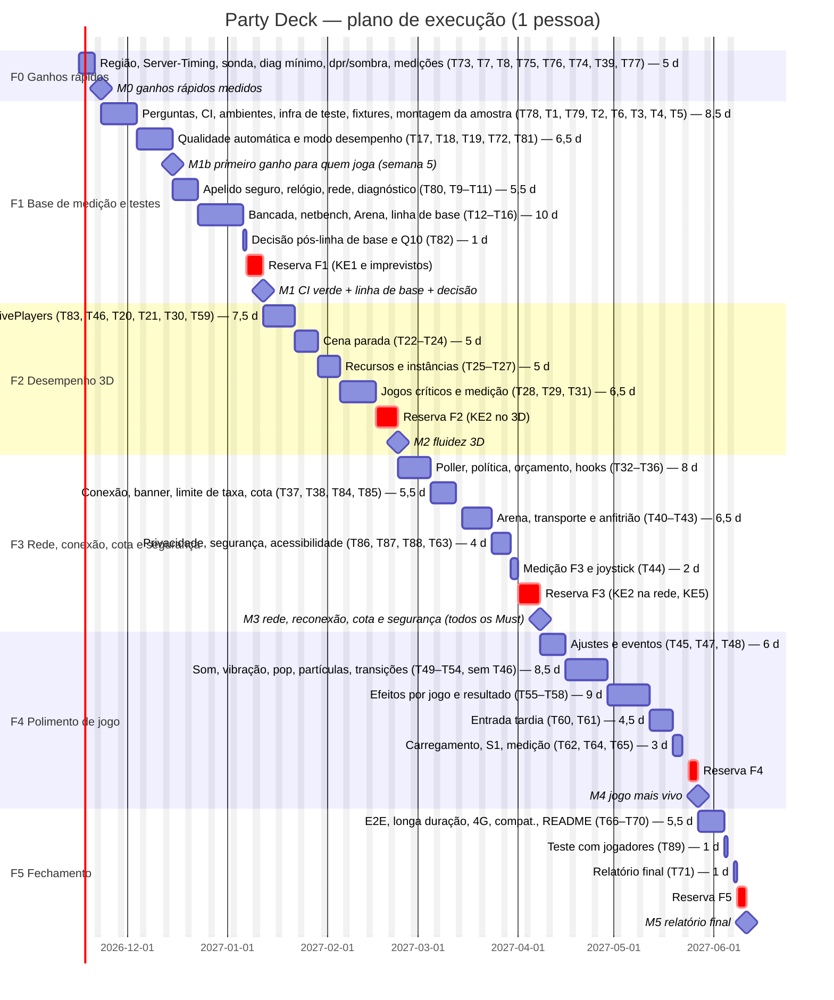

# Plano de execução

> Base: `00-ideia.md`, `01-analise.md`, `02-arquitetura.md`, `03-design.md` e o estado atual de `/home/user/party-deck`. Hoje o repositório tem 13 arquivos de teste só de lógica, `lib/net/{client,clock,useRoom,useSession}.ts`, nenhum CI, nenhuma dependência de teste de tela, `next.config.ts` vazio e nenhum dos módulos novos (C1–C15) implementados. O apelido já é cortado em 12 caracteres na sala (`lib/game/reducer.ts` l. 154) e em 16 na Arena (`lib/arena/room.ts` l. 120), sem remover caracteres de controle. Por isso nada abaixo está "já pronto".
> Unidade: dias-pessoa (d). O cronograma supõe 1 pessoa com 5 dias úteis por semana.

## Estratégia
F0 é uma semana de ganhos rápidos. Ela confirma a premissa de região (A-arq3), mede o servidor de hoje e baixa dpr e sombra nos celulares, para o grupo notar melhora já na semana 1. Em F1 vem a rede de segurança (CI e montagem de uma amostra de telas), seguida da qualidade automática e do modo desempenho (M1b, semana 5). Depois vem a linha de base completa de 3D e rede, medida também contra a configuração anterior (`?q=legado`), que termina num marco de decisão: reestimar F2 e perguntar Q10. F2 (3D) e F3 (rede, cota e segurança) fecham todos os RF "Must" e as condições do júri. F4 (polimento, só Should/Could) pode ser cortado por um gatilho semanal (KE4). F5 fecha com ponta a ponta, um teste com jogadores reais e o relatório das metas. Cada fase tem reserva própria (19 d, 15 %).

## Conflitos encontrados
- **Roteamento de som (A-arq2 × A-des7).** A arquitetura manda o celular tocar só as próprias ações e vitória/derrota. O design manda o celular tocar também os eventos públicos principais (dado, vez, vitória) com volume menor. **Resolução:** uma tabela única de roteamento em `lib/audio` (T49). O padrão é: TV toca todos os eventos públicos; o celular toca as próprias ações, "sua vez" e vitória/derrota, e não toca o dado dos outros (evita o eco de 9 aparelhos citado em A-arq2, mas mantém o aviso de vez do design). Se Q6 for respondida de outra forma, só muda essa tabela.
- **Momento da entrada do espectador (S2/S9/J4 × D11/A-arq5).** O design ora diz "próximo minigame", ora "próxima rodada". A arquitetura promove no próximo minigame (partida rápida), na próxima rodada do tabuleiro (torneio) e só na próxima partida (equipes). **Resolução:** a regra da arquitetura (D11) vale. No torneio, quem está em espera é promovido no início do turno seguinte do tabuleiro. Na partida rápida (um minigame só) e no modo equipes, a promoção acontece só na próxima partida (`resetToLobby`). O selo UI9 e o texto de S2 mudam conforme o modo, lido da view: "entra na próxima rodada" (torneio) ou "entra na próxima partida" (partida rápida e equipes) (T61). Isso responde A-des4.
- **Sala cheia (S2 "Você pode assistir" × contrato `join` → 409).** O design oferece assistir com a sala cheia. A arquitetura responde `409 { error, reason: 'full' | 'name_taken' }` e não cria jogador. **Resolução:** nenhuma mudança no servidor além do `reason`. Com `reason === 'full'` (nunca pelo texto de `error`), o cliente mostra o texto do design e o botão "Assistir" abre a visão somente leitura `/tv?c=` que já existe, sem entrar na sala (T61).
- **Troca de qualidade sem recarregar (A-des1 × D2/KT2).** O design supõe troca imediata. Na arquitetura, o antisserrilhado só muda na criação do contexto e a sombra só muda em troca de fase. **Resolução:** o controlador automático segue D2. A escolha manual "Desempenho" (controle mínimo de T72 em F1, depois a folha completa S3 de T45) aplica dpr e sombra na hora, porque é um engasgo único pedido pelo usuário. O antisserrilhado muda no próximo Canvas. O texto do controle diz "aplicando…" até a próxima cena (T19, T72, T45).
- **Progresso de carregamento (UI6 "N %" × C15 "etapas").** **Resolução:** as três etapas de C15 (código → cena → primeiro quadro) viram 33/66/100 %. Quando a etapa não puder ser detectada, vale a variação indeterminada de A-des5 (T62).
- **Limiares de conexão (UI3/J3 × C5).** O design fixa "lento" com sala > 600 ms ou ping > 120 ms, banner a partir da 3ª falha e "sem conexão" após 15 s. A arquitetura define só os estados. **Resolução:** a máquina de C5 usa os limiares do design (T37), com o ajuste do item seguinte.
- **Limiar "lento" (UI3, 600 ms) × duas faixas de O2 por papel (O2/RF5, C3).** Com a política nova, os celulares `other` consultam a cada 900 ms e têm p95 esperado de ~1,0–1,1 s. Com o limiar único de 600 ms, eles ficariam "lento" o tempo todo sem haver problema. **Resolução:** o limiar de latência da sala segue a faixa do papel: 600 ms para `tv`, `turn` e `next`, e 1,2 s para `other` (ou o valor decidido em Q10). O limiar de ping (120 ms) não muda. As cores da faixa de diagnóstico seguem a mesma regra (T11, T37).
- **Aviso de privacidade e "Sair da sala" (arquitetura JS2/C11e × 03-design).** A arquitetura define o texto do aviso em S1/S2 e a ação `leave` no lobby e em espera. O design ainda não tem o aviso nem o botão. **Resolução:** T86 usa o texto exato da arquitetura, abaixo do campo de apelido, no estilo de texto auxiliar do design. "Sair da sala" entra como ação secundária no lobby do celular (S4) e, depois de T60, em S9. O designer pode mudar a forma, mas não o texto, que é verificado pelo teste de montagem.
- **Ganhos rápidos antes da linha de base (JD1/JU1 × A5/RF18).** F0 e M1b mudam o 3D antes da linha de base completa (T16), e A5/RF18 pedem a base registrada antes das mudanças. **Resolução:** T74 mede as cenas e o servidor antes de qualquer mudança. T76 e T19 mantêm `?q=legado`, que reproduz a configuração anterior (dpr 1,75/1,6, sombra 1024, antisserrilhado). T16 mede todas as cenas com `?q=legado` (base) e com a configuração atual. A região (T39) é mudada em F0, e o "antes" do servidor fica em T74. As mudanças de política de rede só vêm em F3, então a base de rede de T16 continua válida para elas.
- **Nome do comando de medição (A-des6).** **Resolução:** `npm run bench`, `npm run bench:compare` e `npm run netbench`, documentados no README (T13, T14, T70).

## Fases e marcos
### F0 Ganhos rápidos — confirmar a região, medir hoje e entregar o primeiro alívio na semana 1
- Marco M0: A-arq3 confirmada (ou KE3 acionado já na semana 1). O `Server-Timing` de produção foi medido antes e depois de fixar a região. Os celulares abrem com dpr ≤ 1,25 e sem sombra por padrão, e `?diag=1` mostra fps e tempo de quadro.
- Critério de saída: `docs/bench/F0-ganhos-rapidos.md` com antes/depois/Δ de `redis;dur`, `total;dur` e fps de 3 cenas no aparelho de referência (T77).

### F1 Base de medição e testes — rede de segurança, primeiro ganho de uso e linha de base
- Marco M1b (semana 5): qualidade automática (T19) e "Modo desempenho" manual por ⚙ (T72) ativos em todas as telas que usam `Stage3D`. Quem joga num celular fraco nota menos travadas e pode ligar o modo desempenho sozinho. Critério de M1b: ganho de mediana de fps medido em pelo menos 1 cena contra `?q=legado` (T81).
- Marco M1: o CI roda lint, typecheck, test, build e auditoria de dependências em cada PR. A amostra de 5 jogos (TV e celular), o tabuleiro, `HostScreen`, `/play` e `MatchScreen` têm teste de montagem, inclusive com apelido malicioso. O diagnóstico `?diag=1` mostra fps, tempo de quadro e latência da sala por papel. `docs/bench/` tem a linha de base do 3D (todas as cenas, aparelho de referência e TV, com `?q=legado` e atual) e da rede (p95 por papel, frio/quente, comandos por festa, Arena), medida no banco de medição.
- Critério de saída: CI verde no `main`. T16 concluída, com JSONs de linha de base commitados e a lista dos jogos críticos ordenada por pior fps. T82 concluída: F2 reestimada por jogo no ROTEIRO e na tabela de tarefas, cortes de KE4 aplicados se T28 + T29 passarem de 8 d, e Q10 enviada ao usuário com os números.

### F2 Desempenho 3D — fluidez no aparelho de referência
- Marco M2: todas as 26 telas de `SCREENS` com teste de montagem (T83). Qualidade adaptativa em todo Canvas, inclusive o da Arena. "Reduzir movimento" respeitado (T46). Cenas paradas não redesenham. Repetições instanciadas, recursos liberados e mensagem de "sem WebGL". Helper `activePlayers` pronto, se Q9 mantiver RF9.
- Critério de saída: bancada (T31) com mediana ≥ 50 fps e p95 ≤ 33 ms em todas as cenas no aparelho de referência, e ≥ 58 fps na TV/notebook. Se alguma cena não fechar, aciona-se KE2.

### F3 Rede, conexão, cota e segurança — resposta rápida, reconexão e operação sem surpresas
- Marco M3: salas com poller único e política por papel de aparelho e expectativa de ação, com modo economia. Relógio por menor RTT. Chip e banner de reconexão. Limite de taxa na criação de sala e no `join`. Mensagem própria de cota esgotada e alertas configurados. "Sair da sala" e aviso de privacidade em S1/S2. `docs/SEGURANCA.md`. Cabeçalhos de segurança. Acessibilidade corrigida (T63). Arena com serialização única, fila curta, reconexão contínua e aviso de "anfitrião saiu".
- Critério de saída: `netbench` com p95 ≤ 600 ms na TV e no celular da vez e ≤ 1,2 s nos demais celulares (ou a meta decidida em Q10), `p95_frio` e `p95_quente` reportados, e requisições/jogador/min ≤ linha de base. Arena com < 1 % de retratos atrasados > 100 ms no mesmo Wi-Fi. Testes de rede do cliente (RF14) no CI. Auditoria Lighthouse de T63 sem falhas. Banco de medição abaixo de 40 % da cota mensal e produção sem salto de comandos durante as medições (painel do Upstash).

### F4 Polimento de jogo — jogo mais vivo e entrada tardia
- Marco M4: ajustes ⚙ em todas as telas. Som, pops, partículas, transições e vibração nos eventos da lista O5. Espectador tardio. Carregamento com progresso.
- Critério de saída: os 13 jogos e o tabuleiro cumprem a checklist da lista de eventos O5, sem regressão na bancada (T65) em relação ao resultado de T31.

### F5 Fechamento — confiança, teste com jogadores e relatório
- Marco M5: teste de ponta a ponta com 3 clientes no CI, teste de longa duração da TV aprovado, compatibilidade verificada, README atualizado, teste com um grupo real e relatório final das metas O1–O5.
- Critério de saída: todos os critérios de aceite de T66–T71 e T89 cumpridos, e relatório `docs/bench/RELATORIO-FINAL.md` com a situação de cada meta (atingida ou renegociada) e a seção "Teste com jogadores".

## Tarefas
| ID | Fase | Tarefa | Depende de | Origem (RF/C/S) | Estimativa | Critério de aceite |
|---|---|---|---|---|---|---|
| T73 | F0 | Confirmar A-arq3: na documentação e no painel da Vercel (Hobby) e do Upstash (gratuito), verificar se `regions` em `vercel.json` vale no plano gratuito e se a região do banco pode ser escolhida; identificar as regiões atuais (cabeçalho `x-vercel-id` e painel do Upstash); conferir também se a conta permite um segundo banco gratuito (T79) e se há alerta de uso por e-mail (T85) | — | A-arq3, D5, KE3, JD3 | 0,5 | `docs/bench/F0-ganhos-rapidos.md` traz A-arq3 como "confirmada" ou "não confirmada", com fonte (link e data), as duas regiões atuais e as respostas sobre segundo banco e alerta; se não confirmada, KE3 é acionado na semana 1 e o replanejamento de O2 entra em T82, antes de F2 |
| T7 | F0 | `lib/perf/probe.ts`: sonda no Canvas com buffer circular, mediana, p95 e contagem por segundo | — | RF3, C2 | 1 | Testes unitários com tempos sintéticos dão mediana e p95 exatos; o buffer não passa do tamanho fixo |
| T8 | F0 | Servidor: `changedAt` em `toView` e cabeçalho `Server-Timing` (`redis;dur`, `total;dur`, `cmd;desc=<n>` contado em `command()` de `lib/store/redis.ts`, `cold;desc=1` na 1ª requisição de cada instância) nas respostas 200 e 204; publicado em produção | — | C11a/b, RF5, RF18, JD2, JV4, JD3 | 1 | Teste de views confirma `changedAt` = `updatedAt`; teste da rota confirma o cabeçalho nas duas respostas, com `cmd` igual ao número de chamadas ao store falso e `cold` só na 1ª requisição; os testes de views atuais passam (RNF5) |
| T75 | F0 | `?diag=1` mínimo: faixa fixa com fps e tempo de quadro (mediana e p95) da sonda, sem rede nem exportação (T11 amplia) | T7 | RF3, C2, UI11, JD1 | 0,5 | Com `?diag=1` em qualquer tela 3D, a faixa mostra fps e ms p95 atualizados a cada 1 s; sem o parâmetro, a faixa não aparece e a sonda não é montada (verificado no navegador e, depois de T2, pelo teste de montagem de T11) |
| T76 | F0 | Ganho rápido provisório no 3D: em celular (toque e largura < 900 px), teto de dpr 1,25 e sombra desligada por padrão em `Stage3D` e `MatchScreen`; TV e notebook sem mudança; `?q=legado` força a configuração anterior (dpr 1,75/1,6, sombra 1024, antisserrilhado) para medir a base; T19 substitui este padrão pelo controlador | — | RF1, C1, D2, JD1 | 0,5 | No aparelho de referência, `?diag=1` mostra dpr 1,25 e cena sem sombra; com `?q=legado` volta ao anterior; na TV nada muda; lint, typecheck e testes atuais verdes |
| T74 | F0 | Medição "antes" rápida: 50 requisições a uma sala de teste em produção lendo `redis;dur` e `total;dur`, e fps de 3 cenas (tabuleiro e 2 minigames citados pelo usuário; sem resposta, Basquete e Corrida) no aparelho de referência, 60 s cada, com `?diag=1&q=legado` | T8, T75 | RF18, A5, O1, O2, JD3, JD1 | 0,5 | `docs/bench/AAAA-MM-DD-f0-antes.json` com p50/p95 de `redis;dur` e `total;dur` de produção e mediana/p95 de fps das 3 cenas; consumo de comandos da medição anotado (≈ 50) |
| T39 | F0 | Fixar a região das funções em `vercel.json` na região do Upstash (recriar o banco gratuito se preciso), depois da medição "antes" | T8, T73, T74 | RF5, D5, A-arq3, JD1, JD3 | 0,5 | `Server-Timing` `redis;dur` p50 ≤ 20 ms em produção (50 requisições); plano gratuito mantido; se T73 não confirmar A-arq3, a tarefa é cancelada e KE3 registrado |
| T77 | F0 | Medição "depois" e registro de F0: repetir T74 depois de T39 e T76 e publicar a comparação | T74, T39, T76 | RF18, O1, O2, JD1 | 0,5 | `docs/bench/F0-ganhos-rapidos.md` com tabela antes/depois/Δ de `redis;dur`, `total;dur` e fps das 3 cenas; o ganho, ou a falta dele, fica registrado |
| T78 | F1 | Perguntas ao usuário, 1ª rodada (não dependem de dados): Q4 (aparelhos usados), Q8 (jogos e modos piores), Q9 (RF9 é polimento ou modo novo? é prioritário?) e Q7 junto com as restrições do ambiente de desenvolvimento (proxy, máquina sem admin, download de navegador) | — | Q4, Q7, Q8, Q9, JU6, JD6, JV5 | 0,5 | Mensagem enviada na semana 2 com as 4 perguntas; respostas (ou "sem resposta até a semana 4", valendo A1/A4) registradas em `01-analise.md`, e Q9 também em `00-ideia.md`; se Q9 = "não prioritário", T59–T61 vão para o backlog (KE7) e o cronograma é atualizado |
| T1 | F1 | Criar `.github/workflows/ci.yml` (Node 22, cache de npm e de `.next`, `concurrency` que cancela a execução anterior do mesmo ramo, `npm ci`, lint, typecheck, test, build, `npm audit --omit=dev --audit-level=high`) e `.github/dependabot.yml` (npm, semanal) | — | C14, O4, RNF9, JC4, JS5 | 0,5 | PR de teste com erro de tipo fica vermelho; PR limpo fica verde; os 5 passos aparecem separados no log; um 2º push no mesmo ramo cancela o anterior; um PR de teste com dependência de produção vulnerável (versão antiga proposital) fica vermelho; o PR registra se o repositório é público ou privado, o tempo médio de 3 execuções e a estimativa de minutos/mês contra a cota gratuita |
| T79 | F1 | Ambientes de medição (D15, JD2): segundo banco Upstash gratuito só para preview e medição, com `UPSTASH_REDIS_REST_*` separadas por ambiente na Vercel, e `PD_BENCH=1` só no preview; se T73 mostrar que a conta não permite o segundo banco, registrar a alternativa da arquitetura (medições contra `next start` local; rodadas em rede real de ≤ 3 min no banco de produção, com a soma de `cmd`) | T73 | RNF4, KT5, D15, JD2, JV2, JC3 | 0,5 | Pelo painel do Upstash, uma requisição ao preview e uma à produção gastam comandos em bancos diferentes; produção sem `PD_BENCH`; o ROTEIRO diz qual banco cada ambiente usa |
| T2 | F1 | Adicionar deps de dev (`jsdom`, `@testing-library/react`, `@react-three/test-renderer`), ambiente jsdom por arquivo no Vitest, `include` do `vitest.config.mts` ampliado para `tests/**/*.test.{ts,tsx}` e prova de conceito montando 1 tela 3D (Basquete, celular: `BasketController`, que usa `Stage3D`) por importação direta | — | C12, D7, KT3, A6, RNF4, JV5 | 1,5 | Um arquivo `.test.tsx` é coletado pelo Vitest; o teste monta `BasketController` pelo test-renderer, o grafo da cena tem ≥ 1 malha, avança 10 quadros e passa no CI; os testes de lógica atuais seguem em ambiente node; a licença de cada dependência nova (`npm ls` + campo `license`) aparece listada no PR; Playwright não entra em `devDependencies`; se a prova falhar, a decisão de reconciliador nulo (KT3) fica registrada no PR |
| T6 | F1 | Teste de inventário (ids de minigames, `SCREENS`, esportes da Arena contra lista fixa) | — | RF19, C12 | 0,5 | Adicionar um id fictício a qualquer das três listas faz o teste falhar |
| T3 | F1 | Gerador de fixtures de view pelo reducer real (`tests/fixtures/generate.test.ts`) para os 13 minigames e o tabuleiro, por público (TV, jogador), mais teste anti-vazamento | T8 | C12, D8, RNF5 | 2 | `tests/fixtures/views/*.json` gerados para 14 jogos × 2 públicos; o teste falha se algum fixture contiver `secrets`, `seed`, gabarito ou frota (verificado com um fixture adulterado) |
| T4 | F1 | `Stage3D` de teste e teste de montagem para uma **amostra** de `SCREENS` (TV e celular): 1 jogo por tipo de cadência (duelo, turnos, solo, quiz, simultâneo), com mock de `next/dynamic` que resolve o `import()` real (11 dos 13 jogos usam `dynamic` com `ssr:false`); T83 amplia aos demais | T2, T3 | RF15, C12, JD5 | 1,5 | 10 casos (5 jogos × 2 papéis) rodam antes de T16; em cada caso das telas 3D, o teste espera o `import()` resolver e verifica que a cena montou (≥ 1 malha no test-renderer) e que o texto "Carregando 3D…" não está presente; trocar o mock por um `import()` que nunca resolve faz os casos 3D falharem; ao injetar um erro numa tela, a falha diz `Tela de "<id>" (<papel>) lançou erro ao montar: <msg>` e cita "renderizador simulado" |
| T5 | F1 | Teste de montagem do tabuleiro, `HostScreen`, `/play` e `MatchScreen` | T4 | RF15, C12 | 1,5 | 4 telas montam com fixtures e avançam 10 quadros; um erro injetado em cada uma faz o teste falhar |
| T17 | F1 | `lib/three/quality.ts`: controlador puro (janelas de 2 s, duas ruins descem, 10 s > 58 fps sobem, 1 subida/30 s, trava após 2 oscilações) | T7 | RF1, C1, D2, JU1 | 1,5 | Testes com séries sintéticas cobrem descida, subida, limite de 30 s e trava por oscilação |
| T18 | F1 | `lib/prefs.ts` (C9): `partydeck:prefs:v1` e `partydeck:quality:v1`, reaproveitando `localStore`, com fallback quando o storage falha | — | RF2, RF7, RF11, RF12, C9, JU1 | 1 | Testes: valores persistem entre instâncias; com `localStorage` que lança erro, a função funciona em memória e sinaliza a falha |
| T19 | F1 | `QualityProvider` e `Stage3D` aplicando o nível (dpr, sombra 1024/512/sem, AA, `powerPreference`), heurística inicial, nível aprendido, sombra só em troca de fase, hook `useShadowMapSize()` usado por `Lights` e pelas luzes próprias dos jogos com `shadow-mapSize` (ex.: `Board3D`), e lógica do modo "Desempenho" manual; substitui o padrão provisório de T76 e mantém `?q=legado` | T17, T18, T5, T76 | RF1, RF2, C1, D2, KT2, JU1 | 2,5 | Em `?diag=1` a faixa mostra o nível; nenhuma luz com `shadow-mapSize` fixo fora do hook (busca no código); forçar fps baixo (CPU limitada) desce o nível em ≤ 4 s; "Desempenho" persiste após recarregar; `?q=legado` ainda reproduz a configuração anterior; testes de montagem continuam verdes |
| T72 | F1 | Controle mínimo "Desempenho" (prévia de S3/UI1): ⚙ em S1 e nas telas de sala (celular e TV) abre uma folha com um único interruptor "Modo desempenho" e o texto "aplicando…"; T45 depois amplia esta mesma folha | T19 | RF2, S3, UI1, JU1 | 1 | Sem nenhuma queda de qualidade, o usuário liga "Modo desempenho" por ⚙ em S1, no celular em sala e na TV; dpr e sombra mudam na hora (nível visível em `?diag=1`); a escolha persiste após recarregar; `role="switch"`/`aria-checked` e operável só por teclado; teste de montagem da folha passa |
| T81 | F1 | Medição M1b: nas 3 cenas de T74 (ou nas 2–3 piores conhecidas até aqui), fps com qualidade automática e com "Modo desempenho" no aparelho de referência, comparado com `?q=legado` | T19, T72, T75 | RF1, RF2, O1, JU1 | 0,5 | `docs/bench/AAAA-MM-DD-m1b.json` e nota com o Δ da mediana de fps por cena; ao menos 1 cena com ganho medido, ou a falta de ganho registrada como entrada de T82; a nota tem 2–3 linhas sobre "o que muda para quem joga" |
| T80 | F1 | Apelido seguro (JS3): no `join` da sala e da Arena, além do corte atual (12 e 16 caracteres), remover caracteres de controle e invisíveis, aparar espaços e rejeitar nome vazio depois da limpeza; todo texto de jogador é renderizado como texto (sem `dangerouslySetInnerHTML`, `innerHTML` nem rótulo por HTML), inclusive nos novos pontos (pops, faixa de vez, `aria-live`, `label` 3D); os testes de montagem ganham um apelido `` | T5 | RNF5, C11, C12, JS3 | 1 | Teste unitário: nome com caractere de controle é normalizado, nome só com espaços ou invisíveis é rejeitado (409/400 com mensagem), nome longo segue cortado no limite atual; teste de montagem do lobby, do tabuleiro e de 1 minigame com o apelido malicioso não cria nó `img` nem erro; busca no código sem `dangerouslySetInnerHTML`/`innerHTML` com dado de jogador |
| T9 | F1 | Relógio por filtro de menor RTT em `lib/net/clock.ts`, com `serverTime()` e descarte de amostras ruins | — | C4, D9, RF14, RF18 | 1,5 | Com RTT assimétrico simulado (timers falsos), erro de diferença ≤ 20 ms; amostra com RTT > 2× mínimo é descartada; `useServerClock`/`useCountdown` sem mudança de assinatura |
| T10 | F1 | Registrador de rede: latência de mudança (`serverTime − changedAt`, p95), RTT e requisições/min por aparelho, rotulados pelo papel (`tv`, `turn`, `next`, `other`) | T8, T9 | C2, RF3, RF18, JV1 | 1 | Teste unitário com respostas sintéticas dá p95 por papel e req/min corretos |
| T11 | F1 | `DiagOverlay` (S10/UI11) compacta e expandida, ampliando a faixa de T75: `?diag=1`, latência da sala rotulada pelo papel, "Copiar relatório", "Gravar 60 s" em JSON, `renderer.info` e heap | T10, T75 | RF3, RF18, C2, S10, UI11, JS6, JV1 | 2 | Com `?diag=1` a faixa mostra fps, ms (p95), sala ms com o papel e qualidade, com cores verde/amarelo/vermelho pela meta do papel (600 ms para `tv`/`turn`/`next`, 1,2 s para `other`); o relatório copiado e o JSON exportado não contêm código da sala, `playerToken`/token de anfitrião nem apelido (teste falha se contiverem); o JSON exportado valida contra o formato da bancada |
| T12 | F1 | Página `/bench?cena=<id>&s=60` com fixtures e entrada sintética de seed fixa: tabuleiro, 13 minigames (TV/celular) e Arena treino; fora de qualquer menu; aceita `&q=legado`; existe só com `PD_BENCH=1` (D15) | T3, T7, T79 | RF17, C13, A-arq6, D15, JS6 | 2,5 | Cada cena roda 60 s e devolve o JSON; duas execuções seguidas no mesmo aparelho variam ≤ 10 % na mediana de fps; nenhum link para `/bench` no app; sem `PD_BENCH=1`, `/bench` responde 404 (teste da página) |
| T13 | F1 | `scripts/bench.mjs` (Playwright local e opcional, CPU limitada) e `npm run bench:compare` com a tabela antes/depois/Δ/meta de S14; o script carrega o Playwright por `import()` só se estiver presente e aceita `PLAYWRIGHT_BROWSERS_PATH` ou um Chrome já instalado (`CHROME_PATH`) | T12 | RF17, C13, S14, JV5 | 1,5 | Comparação de dois JSONs imprime a tabela de S14 e marca ✓/✗ por meta; sem linha de base, imprime "Sem linha de base para esta cena; esta medição vira a base."; sem Playwright instalado, `bench.mjs` imprime como instalar sem admin e sai sem erro; `npm ci` e `npm test` rodam sem Playwright |
| T14 | F1 | `scripts/netbench.mjs` (`npm run netbench`): N clientes Node; alvo padrão `next start` local com store em memória; `--alvo preview` usa o banco de medição (T79), nunca produção; mede p95 da latência de mudança por papel (`tv`, `turn`, `other`), `p95_frio`/`p95_quente` (`cold` do `Server-Timing`), req/jogador/min, comandos Redis por festa (soma de `cmd`), tamanho do estado por fase e banda estimada por festa; `--politica atual\|nova` simula as cadências por papel; modo Arena reserva mede comandos por requisição. Orçamento de medição: rodadas ≤ 3 min, no máximo 1 rodada em Redis real por tarefa de medição, estimativa de comandos impressa antes de cada rodada em rede real | T8, T79 | RF17, RF18, RNF4, C13, JV2, JC3, JC2, JV4, JD2, KT12 | 2 | Com 8 clientes + TV contra o store local, gera JSON com p95 por papel, frio/quente, req/min e `cmdPorFesta`; duas rodadas variam ≤ 15 %; antes de rodar no preview, imprime a estimativa de comandos e pede confirmação; a rodada da reserva da Arena grava comandos por requisição em `docs/bench`; o ROTEIRO tem a tabela "comandos por rodada × rodadas planejadas por fase" (F1, F3, F5), com total abaixo de 40 % da cota mensal do banco de medição |
| T15 | F1 | Arena: medir retratos atrasados no `SnapBuffer` (C6e), medir a resposta local "entrada→quadro" (do evento do joystick ao primeiro quadro que aplica a nova posição do boneco próprio) e expor RTT, rota, % atrasados e entrada→quadro ao diagnóstico | T7 | C6e, RF3, RF18, O3 | 1,5 | Teste unitário com chegadas sintéticas calcula o atraso pela fórmula de C6e; teste com eventos e quadros sintéticos dá entrada→quadro em quadros; a faixa da Arena mostra ping, % atrasados, rota e entrada→quadro (p95) |
| T16 | F1 | `docs/bench/ROTEIRO.md` e medição da **linha de base**: todas as cenas no aparelho de referência (A2) e na TV, com `?q=legado` (base) e com a configuração atual; `netbench` local nas duas políticas e 1 festa-teste no preview (banco de medição, ≤ 3 min, ≥ 4 celulares + TV, política atual) com p95 por papel e o atraso percebido nos celulares fora da vez; Arena no mesmo Wi-Fi e no 4G, incluindo o passo de resposta local do joystick (O3) | T11, T12, T13, T14, T15 | RF18, RF17, A5, O1–O3, JD4, JV2, JC3 | 2,5 | JSONs `docs/bench/AAAA-MM-DD-<cena>.json` commitados para as duas frentes; ranking dos jogos por pior fps e baseline de req/min registrados no ROTEIRO; p95 por papel (`tv`, `turn`, `other`) e frio/quente da festa-teste registrados, com a observação do atraso percebido; comandos e % da cota gastos em cada rodada em rede real anotados; o ROTEIRO tem o passo "joystick" (entrada→quadro p95 + observação manual) com o valor de base |
| T82 | F1 | Marco de decisão pós-linha de base: (a) com o ranking de fps de T16 e as respostas de Q4/Q8, reestimar T28, T29 e F2 por jogo (hipótese de partida: 1 d por jogo abaixo da meta), quebrando tarefas de mais de 3 d; se T28 + T29 passarem de 8 d, aplicar os cortes de KE4 em F4 antes de começar F2; (b) enviar ao usuário Q10 com os p95 por papel medidos (política atual e nova simulada) e o atraso percebido, pedindo confirmação explícita de A-arq1; (c) se KE3 foi acionado em T73, replanejar O2 para T33 | T16, T78 | O1, O2, RF5, Q4, Q8, Q10, A-arq1, KE4, JV3, JD4, JU6 | 1 | Reestimativa registrada em `docs/bench/ROTEIRO.md`, e a tabela de tarefas deste plano atualizada antes de T22; T28 cita o ranking; mensagem de Q10 enviada com os números; resposta registrada em `01-analise.md` antes de T33 (sem resposta, valem as duas faixas de O2, e KE9 fica em observação) |
| T83 | F2 | Ampliar os testes de montagem de T4 aos 8 jogos restantes (16 casos), na ordem do ranking de T16, antes das mudanças de quadro de T23/T24 | T4, T16 | RF15, C12, JD5 | 1,5 | Os 26 casos de `SCREENS` rodam com os mesmos critérios de T4 |
| T46 | F2 | Hook de reduzir movimento (`system`/`on`/`off`) aplicado ao CSS e ao `Stage3D` (antecipado de F4, fora da lista de corte) | T18, T19 | RF11, C9, RNF7, JU3 | 1 | Com a preferência do sistema emulada no DevTools, ou o interruptor ligado, as cenas não têm tremor nem confete e as transições viram esmaecimento |
| T20 | F2 | Detectar WebGL ausente e `webglcontextlost` e mostrar S13 no Canvas e aviso em linha em S1 | T19 | RNF6, S13, S1 | 1 | Com WebGL desativado no navegador, S1 mostra o aviso e as telas de jogo mostram S13 sem erro no console; teste de montagem com WebGL simulado ausente |
| T21 | F2 | Migrar `MatchScreen` (Arena) para `Stage3D` | T19 | D2, C1, RF1 | 1,5 | A Arena usa `Stage3D` (nenhum `<Canvas>` fora dele: busca no código dá 1 resultado); teste de montagem de `MatchScreen` passa; partida de treino roda sem regressão na bancada |
| T30 | F2 | UI2: aviso "Baixamos a qualidade…" com "Usar modo desempenho", no máximo 1 vez por sessão | T19 | RF1, RF2, UI2 | 0,5 | Ao descer de nível, o aviso aparece uma vez por sessão (também na TV) e o botão ativa o modo persistido |
| T59 | F2 | Entrada tardia, parte 1: helper `activePlayers`, troca dos usos de `state.players` nos 13 minigames e no tabuleiro, testes por minigame com 1 jogador em espera (antecipada de F4 para rodar os testes cedo; se Q9 = "não prioritário" em T78, vai para o backlog com T60–T61) | T78 | RF9, C11c, K7, KT6, JD6 | 2 | Testes atuais passam; novos testes mostram que o jogador em espera não pontua nem age em nenhum minigame |
| T22 | F2 | `Stage3D` com `active` (`frameloop` always/demand), `invalidate()` limitado a 20 fps para ambiente, congelado no nível baixo ou com reduzir movimento | T19, T46 | RF4, C1, D3 | 1 | A sonda conta 0 quadros/s numa cena parada com reduzir movimento e ≤ 20 sem ele; `active` padrão `true` |
| T23 | F2 | Declarar `active` em lobby, votação, tabuleiro (parado fora de movimento) e resultado/fim | T22, T83 | RF4, S4, S5, S8, KT1 | 2 | Bancada: lobby e resultado parados ≤ 20 quadros/s; peão e dado animam por inteiro (checklist visual no ROTEIRO); testes de montagem verdes |
| T24 | F2 | Declarar `active` nas fases de intro e resultado dos 13 minigames e revisar os `useFrame` que precisam de `invalidate` | T22, T83 | RF4, KT1 | 2 | Checklist visual dos 13 jogos sem animação congelada indevidamente; intro e resultado ≤ 20 quadros/s na sonda |
| T25 | F2 | `lib/three/assets.ts` (cache de geometrias e materiais comuns) e `useDisposable` aplicado aos `new THREE.*` em `useMemo` | T5 | RNF2, C10, D13 | 1,5 | **No teste (jsdom + renderizador simulado):** com espiões nos construtores e em `dispose` de `BufferGeometry`, `Material` e `Texture`, montar e desmontar 20 vezes cada minigame chama `dispose` em todo objeto criado por `useDisposable`, e as geometrias e materiais do cache de `assets.ts` são construídos 1 vez só. **Em navegador real (`/bench` com `?diag=1`, C2, aparelho de referência):** após alternar a cena 20 vezes, `renderer.info.memory` (geometrias e texturas) fica no valor da 1ª montagem ± 5 % |
| T26 | F2 | `InstancedMesh` para as casas do tabuleiro e as moedas | T25, T16 | RNF1, C10, O1 | 2 | Chamadas de desenho do tabuleiro (`renderer.info.render.calls`) caem ≥ 50 % em relação à linha de base; visual igual (captura antes/depois no PR) |
| T27 | F2 | `InstancedMesh` para galinhas (Pega Galinha) e células (Batalha Naval) | T25 | RNF1, C10, O1 | 1,5 | Chamadas de desenho dos dois jogos caem ≥ 50 %; testes de montagem verdes |
| T28 | F2 | Otimizar a cena dos 2 jogos piores do ranking de T16 (luzes, sombras por objeto, geometria) | T16, T19, T82 | O1, RNF1, KT10, JV3, JU6 | 3 (reestimada em T82) | Os 2 jogos chegam a mediana ≥ 50 fps e p95 ≤ 33 ms no aparelho de referência, ou a diferença restante fica registrada para KE2 |
| T29 | F2 | Otimizar o 3º jogo pior e a cena da Arena | T28, T21 | O1, RNF1, JV3 | 2 (reestimada em T82) | Mesmo critério de T28 para as duas cenas |
| T31 | F2 | Medição F2: bancada de todas as cenas no aparelho de referência e na TV, comparada com a linha de base | T23, T24, T26, T27, T28, T29 | O1, RNF1, RNF8 | 1,5 | `bench:compare` de todas as cenas commitado; critério de saída de F2 avaliado por cena |
| T32 | F3 | `lib/net/poller.ts`: classe sem React com `fetch` e timers injetáveis (204, descarte fora de ordem, backoff com teto de 4 s; aba oculta **sem nenhuma requisição**: só um timer local de 1 s que checa `document.hidden` ou espera `visibilitychange`, e poll imediato ao voltar a ficar visível); contador das próprias requisições num minuto deslizante que, acima de `NEXT_PUBLIC_PD_MAX_REQ_MIN` (padrão 240), sinaliza economia local por 60 s | — | RF14, C3, C5, D14, JD2 | 2,5 | Testes com timers falsos cobrem 204, resposta fora de ordem descartada, sequência de backoff até 4 s, zero chamadas a `fetch` com a aba oculta por 60 s, poll imediato ao ficar visível e a entrada e saída da economia local ao passar de 240 req/min |
| T33 | F3 | `lib/game/cadence.ts` (client-safe) e `pollPolicy.nextDelay` com `role ∈ tv \| turn \| next \| other`: quente (300 ms) para todos em duelo, quiz e turnos, para a TV em desafio simultâneo e votação, e para TV, celular da vez e do próximo no tabuleiro; morno (900 ms) para `other` no tabuleiro e na votação e para celulares em desafio simultâneo; frio; alinhado ao prazo; `null` quando oculto; modo economia global (`NEXT_PUBLIC_PD_ECONOMY=1`: 900 ms / 1,5 s / 3 s) e local (frio) | T82 | RF5, C3, D4, D14, JV1, JD4, JD2 | 2 | Tabela de casos cobre cada regra e papel; o teste fixa 300 ms para `tv`/`turn`/`next` no tabuleiro e 900 ms para `other`, então mudar a constante do morno exige mudar o teste e registrar a mudança de requisito (JV1, Q10); `hidden` → `null`; economia global e local cobertas; teste confirma que `cadence.ts` não importa código de servidor |
| T34 | F3 | Teste de orçamento: festa simulada de 8 jogadores + TV, torneio de 10 turnos, política nova × atual, sem contar abas ocultas | T33 | RNF4, C12, KT4 | 1 | Teste falha se as req/jogador/min da política nova passarem as da atual; o saldo impresso no log fica perto do previsto em "Orçamento de cota" (~35 → ~33,1 mil req/festa, ≈ −5 %), e o do modo economia global perto de −55 % |
| T35 | F3 | `useRoom` usando poller e política, mantendo a aplicação imediata da view do POST | T32, T33 | RF5, C3 | 1,5 | Testes atuais passam; diagnóstico mostra o intervalo da política e o papel; ação própria reflete na hora |
| T36 | F3 | `useArena` (lobby e vestiário) usando o mesmo poller | T32 | C3, RF14 | 1 | Lobby da Arena funciona com o poller (teste de hook com `fetch` falso) |
| T37 | F3 | `lib/net/connection.ts`: máquina `ok → lento → reconectando → sem rede` com os limiares do design (o de latência da sala segue o papel: 600 ms para `tv`/`turn`/`next`, 1,2 s para `other`) e poll imediato em `online`/visível | T32 | RF6, C5, UI3 | 1 | Testes: 3ª falha → reconectando; 15 s sem resposta → sem rede; evento `online` dispara poll imediato; celular `other` com latência de 1 s fica `ok`, e a TV com 700 ms fica `lento` |
| T38 | F3 | UI3 chip de conexão nas salas, UI4 banner (âmbar/vermelho/"De volta!") e UI5 botões "enviado ✓"/"aguardando conexão" | T37 | RF6, UI3, UI4, UI5, J3 | 2 | Com o modo offline do DevTools no meio de um minigame, aparece o banner, os botões de turno ficam desabilitados e, ao voltar, a tela vai para a fase atual sem recarregar; `role="status"` presente |
| T84 | F3 | Limite de taxa (JS1): contador com TTL no próprio Upstash por origem (IP do cabeçalho da Vercel, guardado só como hash, TTL de 1 min) para `POST /api/rooms` e `join` da sala e da Arena; teto de salas ativas (contador com TTL de 6 h); `429 { error, reason: 'rate' }` com mensagem no cliente ("Muitas tentativas. Espere um minuto e tente de novo."); limites por variável de ambiente, com padrão que comporta uma festa inteira atrás do mesmo Wi-Fi | — | RNF4, C11, KT5, JS1 | 1 | Teste de rota com store em memória: 1 criação + 8 entradas da mesma origem em 1 min passam; a N+1ª criação de sala em 1 min pela mesma origem recebe 429, e a de outra origem não; idem `join`; o teto de salas ativas responde 429; teste de montagem mostra a mensagem; o `netbench` de 8 pessoas + TV não recebe 429 (verificado em T44); comandos extras por criação e entrada somados no orçamento do README (T70) |
| T85 | F3 | Cota esgotada e alertas (JC1, D14): `QuotaError` no store (`lib/store/redis.ts`) ao reconhecer a resposta de limite do Upstash; `errorResponse` → `503 { error, reason: 'quota' }`; mensagem "O limite gratuito deste mês foi atingido. As salas voltam quando a cota renovar." na criação de sala, no `join` e no poll das salas, no lugar do erro genérico; aviso "modo economia" no diagnóstico (global ou local); alertas de 60 % e 80 % (comandos e banda) configurados no painel do Upstash, se o plano oferecer | T11, T33 | RNF4, C11f, C2, D14, KT5, JC1, JD2 | 1,5 | Teste de rota com store falso que devolve o erro de limite → 503 `reason: 'quota'` na criação e no poll; teste de montagem mostra a mensagem em S1 e numa sala; com `NEXT_PUBLIC_PD_ECONOMY=1` o diagnóstico mostra "modo economia"; captura do painel com os alertas, ou nota no README de que o plano não oferece alerta e de que a checagem semanal é o único aviso |
| T40 | F3 | Arena: serialização única por tick para todos os pares e fila do canal rápido de ~16 kB | T15 | O3, C6a/b, D10 | 1 | Teste: N pares recebem a mesma string com 1 `JSON.stringify` por tick; teste de fila descarta retrato velho acima de 16 kB |
| T41 | F3 | Arena: reconexão direta contínua em segundo plano (backoff até 15 s, sem limite de 3 tentativas, reinício em `online`/visível) e testes de troca de transporte com `RTCPeerConnection` falso | T40 | RF6, RF14, C6c | 2 | Testes: queda direta → reserva → volta à direta sozinha; sem limite de tentativas |
| T42 | F3 | Servidor Arena: ação `host_left` em `ARENA_ACTIONS`; a rota `app/api/arena/[code]/action` aceita `hostFromBody(body.auth)` só para `host_left` (sem cabeçalhos `x-pd-*`, token comparado em tempo constante) e grava `hostLeftAt`; a view expõe `hostAway` (`hostLeftAt` há ≥ 10 s, calculado no servidor); qualquer requisição autenticada do anfitrião (GET, ação, `rt`) limpa `hostLeftAt` | — | RF10, C6d, C11d, KT11, JV6 | 1,5 | Testes: `host_left` com token válido no corpo → 204 e `hostLeftAt` gravado, tanto com `Content-Type: text/plain;charset=UTF-8` quanto com `application/json`; token inválido → rejeitado; outra ação com `auth` no corpo e sem cabeçalho → 401; com relógio falso, `hostAway` é `false` antes de 10 s e `true` depois; GET, ação ou `rt` do anfitrião limpa a marca e `hostAway` volta a `false` |
| T43 | F3 | Arena cliente: `sendBeacon(url, JSON.stringify({ action, auth }))` (corpo string, `text/plain`) de `host_left` em `pagehide`; S12 quando a view traz `hostAway: true` ou, sem beacon, após 15 s sem retrato (direto e reserva) e sem mudança da sala vinda do anfitrião; S12 some sozinho se `hostAway` voltar a `false`; "Voltar à sala" e "Esperar mais um pouco" (20 s), distinto de UI4 | T42, T37 | RF10, S12, A-des3, C6d, KT11, JV6 | 2 | Fechar a aba do anfitrião mostra S12 nos jogadores depois da carência de 10 s e em ≤ 13 s; recarregar a aba do anfitrião não mostra S12; com o beacon bloqueado, S12 aparece em ≤ 16 s; com o próprio aparelho offline aparece UI4, não S12; "Voltar à sala" leva ao lobby da Arena |
| T86 | F3 | Privacidade na entrada (JS2, A-arq7): ação `leave` do jogador (entra em `KNOWN`; no lobby remove o jogador de `players` e o token de `secrets.playerTokens`, como o `kick`; depois do lobby → 409); botão "Sair da sala" no lobby do celular; aviso em S1 e S2, abaixo do campo de apelido, com o texto da arquitetura | T5 | C11e, S1, S2, S4, RNF5, JS2 | 1,5 | Teste de rota: `leave` no lobby remove o jogador e o token; depois do lobby responde 409; teste de montagem de S1 e S2 encontra o texto "Use um apelido, não seu nome completo. Ele aparece para quem está na sala e é apagado em até 6 h. Menores de idade: jogue com um responsável."; "Sair da sala" leva a S2 sem sessão (T60 estende `leave` ao jogador em espera) |
| T87 | F3 | `docs/SEGURANCA.md` (1 página, JS4): responsável nomeado; roteiro de incidente (detectar; conter em ≤ 1 h trocando o token REST do Upstash e as chaves TURN na Vercel, com redeploy; `FLUSHDB` para revogar os tokens de jogo; avaliar e comunicar à ANPD e aos titulares em até 3 dias úteis quando houver risco relevante; registrar); política de logs (os da Vercel ficam como são, sem log novo com IP, apelido ou token; hash de IP do limite de taxa com TTL de 1 min); ressalva do Marco Civil art. 15 para pessoa jurídica; base legal e retenção de A-arq7 | T84 | JS4, JS2, A-arq7, RNF5 | 0,5 | Arquivo com no máximo 1 página, nome do responsável preenchido e os 5 passos; link no README; revisão registrada por quem opera o projeto (aprovação no PR) |
| T88 | F3 | Cabeçalhos de segurança em `next.config.ts` (JS5): CSP compatível com three.js e WebRTC (`blob:`/`data:` só onde preciso; `connect-src` com o próprio domínio), `X-Content-Type-Options: nosniff`, `Referrer-Policy: strict-origin-when-cross-origin`, `frame-ancestors 'none'` | T21, T41 | RNF5, RNF6, JS5 | 0,5 | `curl -I` no preview mostra os cabeçalhos; o tabuleiro, 1 minigame 3D e uma partida da Arena (direta e reserva) abrem sem violação de CSP no console; `npm run build` verde |
| T63 | F3 | Acessibilidade: alvos ≥ 44 px (?, ⛶/🔊/✕ da Arena, remover, sair), contraste dos textos da Arena, foco visível e setas na TV, `label` do `Stage3D` com estado, `lang="pt-BR"` (antecipada de F4, fora da lista de corte) | T19 | RNF7, S4, S11, JU3 | 1,5 | Auditoria Lighthouse de acessibilidade, antes de M3, sem falhas de contraste nem de alvo nessas telas; navegação completa da TV só com o teclado |
| T44 | F3 | Medição F3: `netbench` (local e 1 rodada ≤ 3 min no banco de medição) e Arena (mesmo Wi-Fi e 4G) comparados com a linha de base, mais a resposta local do joystick (2ª parte de O3) | T35, T39, T41, T16, T84 | O2, O3, RF5, RNF4, JV1, JD4, JV4, JV2 | 2 | JSONs commitados com p95 por papel como metas: `tv` e `turn` ≤ 600 ms, `other` ≤ 1,2 s (ou a meta decidida em Q10); `p95_frio` e `p95_quente` separados; req/min ≤ base; `cmdPorFesta` e % da cota gasta na rodada registrados; nenhum 429 com 8 + TV; retratos > 100 ms < 1 %; ou KE2 acionado. Joystick, no aparelho de referência com `?diag=1` (medida de T15): entrada→quadro p95 ≤ 1 quadro, com verificação manual do ROTEIRO (10 movimentos, sem atraso visível do boneco próprio mesmo com retratos atrasados) registrada no JSON |
| T45 | F4 | S3 folha de ajustes completa (UI1, UI12), ampliando a folha mínima de T72: gráficos, som, vibração, movimento, diagnóstico; folha inferior no celular e painel lateral na TV; foco preso e `Esc` | T18, T11, T72 | RF2, RF3, RF7, RF11, RF12, S3 | 2 | ⚙ abre S3 em S1, S4–S9 e S11; cada interruptor persiste após recarregar; `role="switch"`/`aria-checked`; navegável só por teclado |
| T47 | F4 | `lib/game/events.ts`: `diffEvents` com os tipos comuns e os eventos do tabuleiro | T3 | RF7, RF8, C7, D6 | 1,5 | Testes com sequências de fixtures geram `dice`, `move`, `coins`, `star`, `turnEnd`, `win`; teste garante que roda só sobre `RoomView` |
| T48 | F4 | `lib/game/eventBus.ts` com as duas fontes (`diffEvents` e `emitLocal`) e tabela de eventos por minigame (lista O5 dos 13 jogos) em `events.ts`, cada evento marcado com `origin: 'public' \| 'local'` pela regra "não altera a view filtrada → local" | T47 | O5, RF8, S7, C7, D6 | 2,5 | Para cada jogo, um teste com fixtures produz pela `diffEvents` cada evento `public` da linha da tabela de S7; teste do barramento: `emitLocal` publica com `origin: 'local'` e a TV não recebe eventos locais; toda linha da tabela tem `origin` (teste de completude) |
| T49 | F4 | `lib/audio` generalizando `sound.ts` (timbre por tipo de evento, desbloqueio no 1º toque, mudo persistente, roteamento TV/celular) e UI10 | T18 | RF7, C8, UI10 | 2 | A Arena continua com os mesmos sons (teste ou checklist); na TV aparece o chip "Toque para ligar o som" até o 1º toque; a tabela de roteamento segue a resolução de conflito |
| T50 | F4 | Ligar o som aos eventos do tabuleiro e dos 13 minigames | T48, T49 | RF7, O5 | 1,5 | Checklist O5: cada evento com som toca na TV e o celular segue a tabela de roteamento |
| T51 | F4 | `lib/haptics.ts`: vibração em acerto, erro e "sua vez", desligável e oculta sem suporte | T48, T18 | RF12 | 0,5 | Testes com `navigator.vibrate` falso; o interruptor some quando não há suporte |
| T52 | F4 | UI8 pop de evento nas salas e região `aria-live="polite"` resumida | T47 | RF8, UI8, RNF7 | 1 | Eventos do tabuleiro mostram o pop e são anunciados uma vez (teste com testing-library) |
| T53 | F4 | `FxLayer`: pool único de partículas em `InstancedMesh` por Canvas, com quantidade por nível de qualidade e clarão com reduzir movimento | T19, T46 | RF8, C8, K1 | 2 | **No teste (jsdom + renderizador simulado):** com espiões nos construtores de `BufferGeometry` e `InstancedMesh`, 100 disparos seguidos não constroem nada além do pool criado na montagem; no nível baixo o pool tem o tamanho mínimo. **Em navegador real (`/bench` com `?diag=1`, C2):** `renderer.info.memory.geometries` não muda durante 100 disparos |
| T54 | F4 | UI7 `PhaseTransition` (cortina de 400 ms, contagem 3-2-1 com som, variações curta e reduzir movimento) | T46 | RF8, RF11, UI7, S6 | 1,5 | As transições lobby→votação→tabuleiro→intro→jogo→resultado rodam; após reconexão usam a versão de 150 ms |
| T55 | F4 | Efeitos do tabuleiro: dado girando localmente até a resposta (A-des2), moedas ±N, estrela, Hora da Sorte, faixa "Vez de…" | T47, T52, T53 | RF8, O5, S5, UI5 | 2 | Checklist O5 do tabuleiro completa; o dado só mostra o número vindo do servidor (nada revelado antes, RNF5) |
| T56 | F4 | Efeitos de evento dos minigames, parte 1: Ping-pong, Tênis, Vôlei, Pênaltis, Basquete, Minigolfe, Corrida. Eventos `public` pelo barramento; eventos `local` com chamadas a `emitLocal` nos controladores (ex.: "aro" no Basquete, "bate no obstáculo" no Minigolfe, "batida" na Corrida) | T48, T53 | RF8, O5, S7, C7, D6 | 3 | Checklist O5 desses 7 jogos completa; para cada evento `local`, teste do controlador com entrada sintética (seed fixa) verifica que `emitLocal` é chamado; na TV, esses fatos aparecem só como placar ("ponto"); no modo desempenho as partículas viram pop 2D |
| T57 | F4 | Efeitos de evento dos minigames, parte 2: Pega Galinha, Fuja do Fantasma, Batalha Naval, Tanques, Quiz Buzz, Chute Certo, com `emitLocal` nos controladores onde a tabela marca `local` (ex.: "perdeu vida" no Fantasma) | T56 | RF8, O5, S7, C7, D6 | 3 | Checklist O5 desses 6 jogos completa; cada evento `local` tem teste do controlador com entrada sintética verificando `emitLocal`; a TV não reage a eventos locais |
| T58 | F4 | S8: pódio revelado 3º→1º com som crescente e confete low-poly ≤ 2 s no fim de jogo, depois cena parada | T53 | RF8, RF4, S8 | 1 | Depois da animação, a sonda mostra a cena parada (≤ 20 quadros/s) |
| T60 | F4 | Entrada tardia, parte 2, com as regras de D11: `status: 'waiting'` em `addPlayer` (mesmos valores iniciais do lobby: 10 moedas, 0 estrelas, `pos: 0`, `peakCoins: 10`), resposta do `join` com `status`, `me.status` na view, `RuleError.reason` incluído por `errorResponse` (`409 reason: 'full' \| 'name_taken'`), promoção no torneio em `endTurn` antes de abrir `turn_roll` e na partida rápida/equipes em `resetToLobby`, promovido no fim de `order[]`, votação contando só `activePlayers`, `leave` também aceito em espera (C11e) | T59, T86 | RF9, C11c, C11e, D11, A-arq5, JS2 | 2,5 | Testes do reducer: entrada após o lobby → `waiting` com os valores iniciais de `addPlayer`; torneio: promoção no início do turno seguinte, quem entra em `vote`/`vote_results` é promovido ao abrir o turno 1, quem entra no último turno ou em `game_over` não é promovido; partida rápida e equipes: promoção só em `resetToLobby`; promovido no fim de `order[]`, `activeIdx` e `totalTurns` inalterados; em espera não vota e o fechamento da votação conta só ativos; promovido entra no ranking e em `winnerIds`; 8 jogadores (ativos ou em espera) → `409 reason: 'full'`, nome repetido → `409 reason: 'name_taken'`; ação de jogo em espera rejeitada; `leave` em espera remove o jogador e o token; sala gravada sem `status` continua funcionando |
| T61 | F4 | Cliente da entrada tardia: S2 "sala em andamento" e "sala cheia" (decidido por `reason === 'full'`, → `/tv?c=`), S9 espectador com "Sair da sala", UI9 com texto por modo ("entra na próxima rodada" no torneio; "entra na próxima partida" na partida rápida e em equipes), linha "Assistindo" no lobby, aviso "Sua vez de entrar! 🎉" | T60 | RF9, S2, S9, UI9, J4 | 2 | Roteiro manual J4 nos 3 modos; o selo mostra o texto do modo; com 409 `reason: 'name_taken'` não aparece a oferta de assistir; teste de montagem de S9 com fixture |
| T62 | F4 | `Loading3D` (UI6) em 3 etapas (33/66/100 %), estado de erro com "Tentar de novo" e `import()` antecipado do próximo jogo em `vote_results`/`minigame_intro` | T19 | RF13, RNF3, C15, S6 | 1,5 | A barra aparece na intro e vira "Pronto ✓"; na aba de rede, o chunk do próximo jogo é baixado antes do início; cada jogo segue em chunk próprio |
| T64 | F4 | S1: ⚙, texto da Arena com Beisebol e "Criando…" com spinner | T45, T20 | S1, UI1 | 0,5 | Os 3 itens visíveis em S1; o teste de montagem de S1 passa (inclusive o aviso de T86) |
| T65 | F4 | Medição F4: bancada de todas as cenas com os efeitos ligados, comparada com T31 | T55, T57, T58 | K1, O1, RNF1 | 1 | Nenhuma cena piora mais de 3 fps na mediana nem passa de p95 33 ms em relação a T31 |
| T66 | F5 | Ponta a ponta pelos handlers das rotas: criar sala, 3 jogadores, 1 minigame até o resultado, verificar que nenhuma view tem dado secreto, relatório narrado | T60, T35, T3 | RF16, C12, RNF5, S14 | 2 | Roda no CI em < 30 s; numa falha, diz o passo e o cliente; uma view com segredo injetado faz o teste falhar |
| T67 | F5 | Teste de longa duração: TV por 2 h de partidas (memória) e 20 min em modo desempenho no aparelho de referência (aquecimento) | T25, T31 | RNF2, RNF8, KT9 | 1 | Memória JS/GPU cresce ≤ 20 % entre a 1ª e a última rodada; sem queda de quadros por aquecimento; resultados em `docs/bench/` |
| T68 | F5 | Verificar a carga inicial do primeiro jogo 3D em Fast 4G | T62 | RNF3 | 0,5 | Primeiro jogo 3D abre em ≤ 4 s (3 medições, mediana) |
| T69 | F5 | Compatibilidade manual: Chrome Android, Safari iOS (2 últimos anos) e Smart TV (WebGL, sem Web Audio, sem WebGL), seguindo a jornada principal | T20, T49 | RNF6, KT8 | 1 | Checklist por navegador no ROTEIRO preenchida, sem bloqueadores abertos |
| T70 | F5 | README: "Medir antes de mexer", comandos de bench, contagem única de testes, "Requisitos de ambiente" (Node 22; Playwright opcional, sem admin, com `PLAYWRIGHT_BROWSERS_PATH`/Chrome instalado; proxy), ressalva "verde no CI não quer dizer sem lag", orçamento de cota com comandos por festa medidos e teto de festas/mês, alertas e quadro da rotina semanal, limites de taxa, regra de roteamento de som e link para `docs/SEGURANCA.md` | T13, T14, T84, T85, T87 | S14, RF17, O4, RNF4, JV5, JD5, JC1 | 1 | O README cita `npm run bench`, `bench:compare` e `netbench`; a contagem de testes bate com a saída do `npm test`; as seções "Requisitos de ambiente" e "Cota e rotina semanal" existem; a ressalva sobre o CI aparece na seção de testes |
| T89 | F5 | Teste com jogadores reais: 1 grupo de 5 a 8 pessoas, aparelhos mistos (incluindo o de referência e a TV), duas partidas seguidas no preview (banco de medição), seguindo a jornada principal; anotar travadas notadas, dúvidas e se pediram outra rodada | T65, T44 | O1–O5, Problema ("segunda partida"), JU2 | 1 | `docs/bench/RELATORIO-FINAL.md` tem a seção "Teste com jogadores" com data, nº de pessoas, aparelhos e ao menos 3 observações, incluindo se o grupo pediu outra rodada |
| T71 | F5 | Relatório final das metas O1–O5 contra a linha de base: p95 por papel e `p95_frio`/`p95_quente` (O2), situação de Q10, comandos por festa medidos e o teto de ~15 festas/mês confirmado ou corrigido pela medição de `cmd`, teste com jogadores; propor renegociação das metas não atingidas (custo zero) | T31, T44, T65, T67, T89 | O1–O5, K8, KT10, JD2, JV4, JU2 | 1 | `docs/bench/RELATORIO-FINAL.md` com tabela meta/base/final/status para cada objetivo, as duas faixas de O2, os dois p95 (frio e quente), o teto de festas/mês e a seção de T89 |

**Totais por fase:** F0 5 d · F1 31,5 d · F2 24 d · F3 26 d · F4 31 d · F5 7,5 d · **total 125 dias-pessoa**, mais 19 d de reserva (15 % do total) distribuídos por fase no cronograma. Todos os RF "Must" se fecham em F0–F3, que somam 86,5 d. A escolha manual do modo desempenho (RF2) tem interface própria em F1 (T72, M1b); T45, em F4, só amplia a folha. Estimativas de T28/T29 são reavaliadas em T82.

## Caminho crítico
Pela cadeia de dependências (término mais cedo de cada tarefa com as estimativas acima), a sequência mais longa tem **20,5 d**:
**T8 → T3 → T4 → T5 → T19 → T46 → T53 → T56 → T57 → T65 → T89 → T71**
(1 + 2 + 1,5 + 1,5 + 2,5 + 1 + 2 + 3 + 3 + 1 + 1 + 1 = 20,5 d: view com `changedAt` → fixtures → montagem da amostra → montagem de tabuleiro/HostScreen/Arena → `Stage3D` com qualidade → reduzir movimento → pool de partículas → efeitos por jogo → medição F4 → teste com jogadores → relatório).

A segunda cadeia, quase crítica, é a da fluidez 3D, com 19 d: **T8 → T3 → T12 → T13 → T16 → T82 → T28 → T29 → T31 → T67 → T71** (1 + 2 + 2,5 + 1,5 + 2,5 + 1 + 3 + 2 + 1,5 + 1 + 1). A cadeia de rede tem 17 d: T8 → T3 → T12 → T13 → T16 → T82 → T33 → T35 → T44 → T71.

Com 1 pessoa, o prazo é definido pelo esforço total (125 d + 19 d de reserva + 5 d de arredondamento = 149 dias úteis ≈ 30 semanas). As cadeias acima definem o que não pode atrasar dentro de cada fase. Os pontos de estrangulamento são três. A linha de base (T16) e o marco de decisão (T82): T26, T28, T29, T33, T44 e todas as comparações dependem deles. O `Stage3D` com qualidade (T19): todo o 3D de F2 e F4 depende dele. A confirmação de região (T73), na semana 1, que decide se KE3 entra. Com uma 2ª pessoa, F3 roda em paralelo a F2 (depende só de F1), e T59–T61 rodam em paralelo aos efeitos de F4. A estimativa grosseira fica em ~20 semanas, sem Gantt detalhado.

## Cronograma
Supõe 1 pessoa, início em 16/11/2026 e dias úteis apenas (feriados não descontados; o recesso de fim de ano cai em F1 e consome a reserva da fase, se tirado).

Cada bloco tem duração ≥ à soma das suas tarefas (arredondada para cima ao dia inteiro). No total são 149 dias úteis: 125 d de tarefas, 19 d de reserva (F1 3, F2 5, F3 5, F4 3, F5 3) e 5 d de arredondamento. Em resumo: F0 na semana 1; F1 das semanas 2 a 9, com M1b no início da semana 5 (14/12/2026); F2 das semanas 9 a 15; F3 das 15 a 21; F4 das 21 a 28; F5 das 28 a 30, com fim previsto em 10/06/2027. Toda sexta-feira há um ponto de controle de 15 min, que compara o feito com o Gantt (gatilho de KE4).

## Testes e qualidade
- **Jornada principal de aceitação** (resumo de J1–J3 de `03-design.md`, usada em T69 e T89): (1) criar a sala: S1 → lobby na TV (S4, `/host` ou `/tv`); (2) entrar pelo QR: S2 com apelido e aviso de privacidade → lobby no celular (S4); (3) jogar: tabuleiro (S5) → intro com carregamento (S6) → minigame (S7) → resultado (S8); (4) cair a rede: chip UI3 → banner UI4 âmbar/vermelho, botões "aguardando conexão" (J3); (5) voltar: o aparelho volta à fase atual sem recarregar e mostra "De volta!".
- **Unitários (Vitest, ambiente node):** controlador de qualidade, sonda, registrador de rede (por papel), relógio, poller (com economia local), política (por papel, com economia global e local), máquina de conexão (limiar por papel), `diffEvents`, prefs, haptics, transporte da Arena (serialização, fila, reconexão), `host_left` (`text/plain` e `application/json`), `activePlayers`, entrada tardia, normalização de apelido. Timers e `fetch` falsos, sem rede real.
- **Rotas e segurança (Vitest, handlers com store em memória ou falso):** `Server-Timing` com `cmd` e `cold` (T8); 429 do limite de taxa sem bloquear uma festa atrás do mesmo Wi-Fi (T84); 503 `reason: 'quota'` (T85); `leave` no lobby, em espera e recusado depois do lobby (T86, T60); `/bench` 404 sem `PD_BENCH=1` (T12); relatório de diagnóstico sem código da sala, token nem apelido (T11); apelido malicioso sem virar marcação (T80); `npm audit --omit=dev --audit-level=high` no CI (T1); cabeçalhos de segurança verificados no preview (T88).
- **Orçamento (Vitest):** a festa simulada de T34 compara req/jogador/min da política nova com a atual. Bloqueia o merge se piorar (RNF4).
- **Tela (Vitest + jsdom + test-renderer):** arquivos `.test.tsx` (o `include` é ampliado em T2). Montagem de uma amostra de 5 jogos (T4), das telas fixas (T5) e depois de todas as 26 (T83), mais S1/S2 com o aviso, S9, folha de ajustes e pops. As telas carregadas por `next/dynamic` têm o `import()` resolvido por mock, e o teste exige a cena montada, não o "Carregando 3D…". Renderizador simulado, sem medição de quadros nem shader (D7): **verde no CI não quer dizer sem lag**, e isso fica escrito no README (T70). Os fixtures vêm do reducer real (T3).
- **Memória de recursos 3D:** no teste, só espiões em construtores e `dispose` (T25, T53), porque `renderer.info` não reflete memória real sem WebGL. `renderer.info` é lido apenas em navegador real (`/bench` + `?diag=1`, C2) e no teste de longa duração (T67).
- **Eventos locais:** chamadas a `emitLocal` testadas nos controladores com entrada sintética e seed fixa (T56, T57); eventos públicos por `diffEvents` sobre fixtures (T47, T48).
- **Segurança de dados:** teste anti-vazamento nos fixtures (T3) e em cada resposta do ponta a ponta (T66). Os testes de views atuais seguem obrigatórios (RNF5).
- **Inventário:** T6 impede jogo, modo ou esporte novo sem decisão consciente (RF19).
- **Ponta a ponta (Vitest, handlers das rotas, store em memória):** T66 no CI.
- **Desempenho (manual + script):** `/bench` no aparelho de referência (A2) e na TV, com `?q=legado` para a base, `bench:compare` contra a linha de base, `netbench`, teste de longa duração de 2 h e de 20 min (T67), checklist visual de animações (KT1).
- **Orçamento de medição (cota):** `netbench` roda por padrão contra `next start` local com store em memória (zero cota). Em rede real, só no banco de medição do preview (T79), com rodadas ≤ 3 min, no máximo 1 rodada por tarefa de medição (T16, T44, T89), estimativa de comandos antes de rodar e consumo registrado depois. Meta: banco de medição abaixo de 40 % da cota mensal ao fim de F3, e produção sem salto de comandos durante as medições.
- **Compatibilidade (manual):** T69.
- **Ambientes:** local (store em memória; alvo padrão do `netbench`); CI do GitHub Actions (sem segredos; Playwright fora do CI); preview da Vercel com banco Upstash de medição e `PD_BENCH=1`; produção com o banco de produção e sem `/bench`. Nenhuma tarefa de F0–F3 exige instalação com permissão de administrador: as deps de dev entram por `npm ci`, e o Playwright é opcional (T13). Restrições de proxy e rede do dono são perguntadas em T78 (Q7).
- **Definição de pronto (cada tarefa):** critério de aceite cumprido. Teste automatizado novo ou atualizado (O4); se a tarefa for só de medição ou manual, o JSON ou checklist commitado. `npm test`, `lint`, `typecheck`, `build` e `npm audit` verdes no CI. Sem regressão na bancada para tarefas que tocam o 3D (comparação anexada ao PR). Textos em pt-BR conforme o tom do design. Nenhum dado secreto novo na view e nenhum texto de jogador renderizado como HTML. Dependência nova com licença listada no PR.

## Riscos de entrega
- **KE1:** `@react-three/test-renderer` incompatível com React 19/Vitest 5/jsdom (KT3). Gatilho: a prova de conceito de T2 falha após 1 d. Contingência: o `Stage3D` de teste usa um reconciliador nulo, e os componentes de cena são testados isoladamente. T4, T5 e T83 ganham até +1 d no total (sai da "Reserva F1"), e RF15 continua atendido pela montagem do DOM.
- **KE2:** as metas O1/O2/O3 não fecham no aparelho de referência ou em redes ruins (K8, KT10). Gatilho: T31 ou T44 com cena ou rede fora da meta depois de T28/T29. Contingência: até 5 d extras de otimização dirigida pela bancada em cada frente ("Reserva F2" para o 3D, "Reserva F3" para a rede). Se ainda assim não fechar, as metas são renegociadas com o usuário em T71, sem custo, com os números medidos.
- **KE3:** não é possível fixar a região das funções ou do Upstash no plano gratuito (A-arq3). Gatilho: T73 não confirma A-arq3 (semana 1). Contingência: T39 é cancelada; T82 replaneja O2 antes de F2, e a política de polling (T33) assume o ganho sozinha; a latência por região fica registrada como limite em T71.
- **KE4:** o esforço estoura (K5): 125 d (+19 d de reserva) para 1 pessoa. Gatilho semanal: no ponto de controle de sexta-feira, atraso acumulado maior que a reserva restante da fase, ou F0+F1 não concluídas até o fim da semana 9; também dispara em T82 se T28 + T29 reestimadas passarem de 8 d. Contingência, aplicada assim que o gatilho dispara: cortar F4 nesta ordem, dos itens de menor valor para os de maior: T51 (Could), T62 (Could), T57/T56 (efeitos por jogo, ficam só som + pop), T60–T61 (RF9). **Fora da lista de corte:** todas as tarefas de Must; T46 (RF11) e T63 (RNF7), que agora estão em F2 e F3; T83 (RF15, Must); T80 e T84–T88 (condições de segurança, cota e privacidade).
- **KE5:** a cota gratuita do Upstash se esgota durante as medições (KT5). Gatilho, antes de cada rodada em rede real: a estimativa impressa pelo `netbench` (T14) somada ao uso do mês passa de 40 % da cota do banco usado; ou o painel de produção mostra salto de comandos durante uma medição. Contingência: a rodada não é feita em rede real e passa para `next start` local; Arena medida via WebRTC direto; o restante é adiado para o mês seguinte. Se não houver segundo banco (T79), toda medição em rede real usa esse mesmo gatilho contra o banco de produção.
- **KE6:** o aparelho de referência (A2) ou a Smart TV não estão disponíveis. Gatilho: T74 ou T16 sem aparelho. Contingência: Chrome desktop com CPU limitada 4× via `bench.mjs` como substituto temporário, com a ressalva registrada nos JSONs; repetir no aparelho real antes de T31.
- **KE7:** o usuário considera RF9 um modo novo ou não prioritário (Q9). Gatilho: resposta a Q9 em T78 (semanas 2–4). Contingência: T59–T61 vão para um backlog fora do plano base (−6,5 d), mantendo apenas a mensagem atual de "a partida já começou" melhorada no S2.
- **KE8:** `frameloop="demand"` congela animações não percebidas pelos testes (KT1). Gatilho: checklist visual de T23/T24 com falha ou relato do usuário. Contingência: a tela volta a `active=true` (padrão seguro) e o `useFrame` problemático ganha `invalidate`; correção em até 0,5 d por tela.
- **KE9:** o usuário recusa a faixa de 1,2 s para os celulares fora da vez (Q10). Gatilho: resposta a Q10 depois de T82. Contingência: T33 testa a variante "morno de 750 ms" (custo ≈ +1,6 mil comandos por festa, ainda dentro de RNF4). Se nem isso bastar e for exigido 600 ms em todos os aparelhos (~+12 mil por festa), O2 e RNF4 são renegociados com o usuário antes de T35, com os números de T16.
- **KE10:** o limite de taxa (T84) bloqueia uma festa legítima: todos atrás do mesmo IP do Wi-Fi ou em CGNAT do 4G. Gatilho: 429 relatado numa festa ou no `netbench` de T44. Contingência: subir os limites pela variável de ambiente (sem deploy de código) e, se preciso, contar por código de sala em vez de por origem no `join`.

### Perguntas em aberto ao usuário
- Q4 (aparelhos do grupo) e Q8 (jogos e modos piores): enviadas em T78; respostas orientam T28/T29 junto com o ranking de T16 (T82).
- Q7 (CI fora do repositório) e restrições de rede do ambiente de desenvolvimento (proxy, sem admin, download de navegador): enviadas em T78.
- Q9 (RF9 é polimento? é prioritário?): enviada em T78, antes de F2; decide se T59–T61 ficam (KE7).
- Q10 (faixa de 1,2 s nos celulares fora da vez): enviada em T82 com os números medidos; decide T33 (KE9).
- Q5 (estilo) e Q6 (som na TV e/ou nos celulares) continuam abertas; sem resposta, valem A7 e a tabela de roteamento de T49.

## Rastreabilidade
| Requisito | Tarefa(s) |
|---|---|
| RF1 [Must] qualidade automática | T76, T17, T19, T21, T30, T81 |
| RF2 [Must] modo desempenho persistente | T18, T19, T30, T72 (escolha manual em F1, M1b), T81; T45 amplia em F4 |
| RF3 [Must] diagnóstico fps/quadro/latência | T7, T75, T10, T11, T15, T45 |
| RF4 [Must] não redesenhar cena parada | T22, T23, T24, T58 |
| RF5 [Must] mudança visível dentro de O2 (600 ms TV e celular da vez; 1,2 s demais, Q10) | T8, T73, T74, T39, T77, T10, T14, T16, T82, T33, T35, T37, T44 |
| RF6 [Must] reconexão sem recarregar | T32, T37, T38, T41 |
| RF7 [Should] sons + silenciar | T47, T48, T49, T50, T45 |
| RF8 [Should] transições e efeitos | T52, T53, T54, T55, T56, T57, T58 |
| RF9 [Should] entrar após o lobby | T78 (Q9), T59, T60, T61 |
| RF10 [Should] anfitrião da Arena saiu | T42, T43 |
| RF11 [Should] reduzir movimento | T46 (F2, fora de corte), T22, T54, T45 |
| RF12 [Could] vibração | T51, T45 |
| RF13 [Could] carregamento com progresso | T62 |
| RF14 [Must] testes de rede do cliente | T9, T32, T36, T41 |
| RF15 [Must] teste de renderização por tela | T2, T3, T4, T5, T83 |
| RF16 [Should] ponta a ponta multi-cliente | T66 |
| RF17 [Should] roteiro de medição | T12, T13, T14, T16, T79, T70 |
| RF18 [Must] medição das duas frentes + linha de base | T8, T9, T10, T11, T14, T15, T16, T74, T77 |
| RF19 [Must] sem jogo/modo novo | T6, T12 (sem menu, só com `PD_BENCH=1`) |
| RNF1 desempenho | T26, T27, T28, T29, T31, T65, T81 |
| RNF2 memória 2 h | T25, T67 |
| RNF3 carga inicial ≤ 4 s | T62, T68 |
| RNF4 custo zero / req ≤ hoje / sem IA / licenças | T2 (licenças), T14, T34, T44, T79, T84, T85, T70 |
| RNF5 sem vazar dados | T3, T8, T11, T55, T66, T80, T86, T88 |
| RNF6 compatibilidade / sem WebGL | T20, T69, T88 |
| RNF7 acessibilidade | T46, T52, T63 (F3, fora de corte), T45 |
| RNF8 bateria/temperatura | T31, T67 |
| RNF9 suíte atual + CI | T1, T2 |
| O2 por papel de aparelho (Q10, A-arq1) | T10, T11, T14, T16, T82, T33, T37, T44, T71 |
| O3 Arena: retratos atrasados e resposta local do joystick | T15, T16, T40, T41, T44 |
| O5 lista de eventos por jogo | T48, T50, T55, T56, T57 |
| Problema: "segunda partida" com grupo real | T89, T71 |
| Cota e operação (KT5, KT12, D14, D15) | T8, T14, T32, T33, T79, T85, T70, T71 |
| Segurança e privacidade (A-arq7, LGPD) | T1 (audit), T80, T84, T86, T87, T88 |
| Perguntas Q4, Q7, Q8, Q9, Q10 | T78, T82 |
| UI (S1, S2, S3, S4, S9, S10, S12, S13, UI1–UI12) | T11, T20, T30, T38, T43, T45, T49, T52, T54, T61, T62, T64, T72, T75, T85, T86 |
| Condições do júri, rodada 1 | JV1: T10, T11, T33, T44 · JC1: T85 · JC2: T14 · JS2: T86, T60 · JS4: T87 · JD2: T14, T32, T33, T79, T71 · JD4: T16, T82, T44 · JV2/JC3: T14, T16, T79, KE5 · JV3: T82 · JS1: T84 · JS3: T80 · JU1: T17–T19, T72, T81 (M1b) · JU2: T89 · JU3: T46, T63 · JD1: F0 (T73–T77, T7, T8, T39), KE4 · JD3: T73, T74 |

Todos os RF "Must" (RF1–RF6, RF14, RF15, RF18, RF19) têm tarefas em F0–F3, inclusive a interface de escolha manual do modo desempenho (RF2, T72 em F1) e a montagem de todas as telas (RF15, T83 em F2). Cortar F4 (KE4) não deixa nenhum Must, nem RF11/RNF7, nem condição do júri sem entrega.

## Histórico de revisão
- R2: nova tarefa T72 (F2, 1 d): controle mínimo "Desempenho" por ⚙ em S1 e nas salas (celular e TV), independente da queda de qualidade. T45 passa a depender de T72 e só amplia a folha. M2, o conflito "Troca de qualidade", a rastreabilidade de RF2 e as frases sobre os Must em F1–F3 foram atualizados.
- R4: T2 faz a prova de conceito com uma tela 3D (`BasketController`, que usa `Stage3D`) e amplia o `include` do `vitest.config.mts` para `tests/**/*.test.{ts,tsx}` (1 → 1,5 d). T4 usa mock de `next/dynamic` que resolve o `import()` real e exige a cena montada (≥ 1 malha, sem "Carregando 3D…") (2 → 3 d). A seção de testes foi ajustada.
- R5: os critérios de T25 e T53 foram divididos por ambiente. No teste, espiões em construtores e `dispose`; em navegador real (`/bench` + `?diag=1`), `renderer.info.memory`. A seção de testes diz onde cada verificação roda.
- R10: o caminho crítico foi recalculado pelo término mais cedo. A cadeia antiga somava 17,5 d e não era a mais longa. A crítica agora é T8 → T3 → T4 → T5 → T19 → T46 → T53 → T56 → T57 → T65 → T71 (21 d), e a cadeia 3D tem 18,5 d. No Gantt, cada bloco tem duração ≥ à soma das tarefas (f1c 9 d, f4e 5 d etc.), com reservas explícitas "KE1" (+1 d, fim de F1) e "KE2" (+3 d, antes de M3). Os totais, o prazo (≈ 24 semanas) e os gatilhos e números de KE4/KE7 foram atualizados.
- R11: T15 passa a medir "entrada→quadro" do joystick na Arena (1 → 1,5 d). T16 inclui o passo "joystick" no ROTEIRO com valor de base. T44 verifica p95 ≤ 1 quadro mais a checagem manual (1 → 1,5 d). Nova linha O3 na rastreabilidade.
- R1 (arquitetura, C3): T32 trata a aba oculta sem nenhuma requisição (timer local de 1 s + poll imediato ao voltar). Para coerência, T33 devolve `null` quando oculto e restringe o quente no tabuleiro à TV e ao próximo jogador, e T34 confere o saldo previsto (≈ −9 %).
- R3 (arquitetura, C7/D6): T48 cria `eventBus.ts` com `diffEvents` + `emitLocal` e marca `origin` em cada evento da tabela (2 → 2,5 d). T56/T57 incluem `emitLocal` nos controladores, com testes de entrada sintética (2,5 → 3 d cada).
- R6 (arquitetura, C6d/C11d): T42 usa `ARENA_ACTIONS`, `hostFromBody(body.auth)`, `hostAway` com carência de 10 s e limpeza por qualquer requisição do anfitrião (1 → 1,5 d). T43 usa `hostAway` e a dedução de 15 s sem beacon, e a recarga não mostra S12.
- R7 (arquitetura, D11): T60 detalha as regras de promoção (quando, valores iniciais, ordem, turnos, votação, ranking) (1,5 → 2,5 d). O conflito "Momento da entrada" e T61 mudam: a partida rápida também promove só na próxima partida.
- R8 (arquitetura, C1): T19 inclui o hook `useShadowMapSize()` em `Lights` e nas luzes dos jogos (2 → 2,5 d).
- R9 (arquitetura, contrato `join`): T60 inclui `RuleError.reason` em `errorResponse`. T61 e o conflito "Sala cheia" decidem por `reason === 'full'`.
- JV2: T14 ganhou o orçamento de medição (rodadas ≤ 3 min, no máximo 1 rodada em Redis real por tarefa de medição, alvo padrão `next start` local com store em memória, estimativa antes de rodar) e a tabela de comandos por fase no ROTEIRO. Nova T79 cria o banco de medição separado. T16 registra a cota gasta por rodada. Critério de saída de F3: banco de medição abaixo de 40 % e produção sem salto.
- JV3: nova T82 (marco de decisão no fim de F1): reestima T28/T29 e F2 por jogo com o ranking de T16 (1 d por jogo abaixo da meta) e aplica os cortes de KE4 antes de F2 se a soma passar de 8 d. Registro no ROTEIRO e nesta tabela antes de T22. Critério de saída de F1 cita a reestimativa.
- JC3: banco Upstash separado para preview e medição (T79), `netbench` local por padrão e rodadas curtas com consumo registrado (T14, T16, T44). O gatilho de KE5 deixou de ser "60 % no painel" e passou a ser a estimativa feita antes de cada rodada (uso do mês + estimativa > 40 %).
- JS1: nova T84 (F3, 1 d): limite de taxa por origem (hash do IP, contador com TTL no Upstash) em criação de sala e `join`, teto de salas ativas e `429 reason: 'rate'` tratado no cliente. O padrão comporta 1 criação + 8 entradas pela mesma origem, para não barrar a festa no mesmo Wi-Fi (novo KE10). Comandos extras entram no orçamento do README (T70).
- JS3: nova T80 (F1, 1 d): normalização do apelido no servidor (sala e Arena, mantendo os cortes atuais de 12 e 16 caracteres, com remoção de caracteres de controle e invisíveis e rejeição de nome vazio) e testes de montagem com ``.
- JU1: novo marco M1b (semana 5, 14/12/2026). T17, T18, T19 e T72 passaram de F2 para F1, logo depois da amostra de montagem (T4, T5), e T81 mede o ganho de fps contra `?q=legado`. A sequência ficou T4 + T5 antes de T19, e não só T7/T11/T12, para manter a proteção de K3. A linha de base completa (T16) vem depois.
- JU2: nova T89 (F5, 1 d): teste com um grupo real de 5 a 8 pessoas, duas partidas seguidas, seção "Teste com jogadores" no relatório final. T71 depende de T89 e cita o resultado.
- JU3: T46 passou para F2 (também antes de T22, que usa "reduzir movimento") e T63 para F3 (Lighthouse antes de M3). KE4 declara as duas fora da lista de corte. Rastreabilidade de RF11 e RNF7 atualizada.
- JD1 (parcial): nova fase F0 de 5 d, com T73, T7, T8, T75 (`?diag=1` mínimo), T76 (teto de dpr e sombra desligada no celular), T74/T77 (antes/depois) e T39, que saiu de F3. A reserva subiu para 19 d (15 % de 125 d), distribuída por fase. O gatilho de KE4 virou semanal (ponto de controle às sextas e F0+F1 até a semana 9). **Não aplicado:** cortar T4/T5 para uma amostra de 3 jogos como contingência. RF15 é Must e exige teste de cada tela (01-analise.md), então T83 (ampliação) fica fora da lista de corte, e o gatilho semanal corta F4 mais cedo.
- JD3: nova T73 (0,5 d, dia 1) confirma A-arq3 na documentação e no painel. T8 foi antecipada para F0, e T74 mede o `Server-Timing` de produção antes de T39. O gatilho de KE3 passou a ser T73 (semana 1).
- JV5: T2 não põe Playwright em `devDependencies`. T13 carrega o Playwright só se ele existir e aceita `PLAYWRIGHT_BROWSERS_PATH` ou `CHROME_PATH`. T70 ganhou "Requisitos de ambiente". T78 pergunta sobre proxy e rede junto com Q7. "Testes e qualidade" declara que nada em F0–F3 exige admin.
- JC4: T1 registra a visibilidade do repositório, o tempo médio de execução e os minutos/mês estimados, e usa `concurrency` e cache de `.next`.
- JS5: T1 ganhou `npm audit --omit=dev --audit-level=high` e Dependabot. Nova T88 (F3, 0,5 d) com cabeçalhos de segurança em `next.config.ts`, verificados com o 3D e a Arena abrindo.
- JU4: os dois arquivos existem em `docs/plano/`. Mesmo assim, "Testes e qualidade" ganhou a jornada principal em 5 passos com as telas de cada passo, usada em T69 e T89.
- JU6: Q4 e Q8 viraram perguntas abertas, enviadas em T78 (semana 2), sem resposta presumida. T82 e T28 usam o ranking de T16 e as respostas. Nova subseção "Perguntas em aberto ao usuário".
- JD5: T4 virou amostra de 5 jogos (1 por tipo de cadência, 10 casos, 3 → 1,5 d) antes de T16. Nova T83 amplia aos 26 casos depois de T16 e antes de T23/T24. A ressalva "verde no CI não quer dizer sem lag" vai para o README (T70) e para "Testes e qualidade".
- JD6: Q9 é enviada em T78 (semana 2), antes de F2 e de F3. T59 passou para F2. Se Q9 = "não prioritário", T59–T61 vão para o backlog (KE7, gatilho atualizado).
- JV1 (analista, reconciliação): T10 e T11 rotulam a latência pelo papel. T33 usa os papéis `tv`/`turn`/`next`/`other`, e um teste fixa 900 ms para `other`. T44 mede as duas faixas como metas. M3, KE9 e a linha O2 da rastreabilidade foram atualizados. Novo conflito: o limiar "lento" segue a faixa do papel (T37).
- JC6 (analista, reconciliação): T2 lista a licença de cada dependência nova no PR. A definição de pronto e a rastreabilidade de RNF4 citam licenças.
- JC1 (arquiteto, condição → tarefa): nova T85 (F3, 1,5 d): `QuotaError` → `503 reason: 'quota'`, mensagem "quando a cota renovar", aviso de modo economia no diagnóstico, alertas de 60/80 % no painel. A rotina semanal vai para o README (T70).
- JC2 (arquiteto, condição → tarefa): T14 mede comandos por requisição da reserva da Arena, o tamanho do estado por fase e a banda por festa (KT12), e grava em `docs/bench`.
- JS2 (arquiteto, condição → tarefa): nova T86 (F3, 1,5 d): ação `leave` no lobby, "Sair da sala" e aviso de privacidade em S1/S2 com teste do texto. T60 estende `leave` ao jogador em espera e T61 põe "Sair da sala" em S9. Novo conflito registrado (o design ainda não tem o aviso).
- JS4 (arquiteto, condição → tarefa): nova T87 (F3, 0,5 d): `docs/SEGURANCA.md` com responsável, roteiro de incidente e política de logs.
- JD2 (arquiteto, condição → tarefa): modo economia local em T32 e global em T33, banco separado em T79, `cmd` do `Server-Timing` em T8 e T14. T71 registra o teto de ~15 festas/mês (o "12" foi recalculado pela arquitetura) confirmado pela medição.
- JD4 (arquiteto, condição → tarefa): T16 inclui a festa-teste com p95 por papel e o atraso percebido nos celulares fora da vez. T82 leva os números ao usuário com Q10 antes de F3. T33 deixa quente também o celular da vez no tabuleiro. T34 passa a conferir saldo de ≈ −5 % (antes −9 %), e T44 tem a métrica por papel como meta.
- JV4 (arquiteto, reconciliação): T8 emite `cold;desc=1`. T14 e T44 reportam `p95_frio` e `p95_quente`, e T71 cita os dois.
- JV6 (arquiteto, reconciliação): T42 testa `host_left` com `text/plain;charset=UTF-8` e com `application/json`. T43 envia o corpo como string.
- JS6 (arquiteto, reconciliação): T11 exige relatório sem código da sala, token nem apelido. T12 exige `/bench` só com `PD_BENCH=1` (404 em produção), ligado no preview por T79.
- Totais, caminho crítico (20,5 d: T8 → T3 → T4 → T5 → T19 → T46 → T53 → T56 → T57 → T65 → T89 → T71), Gantt (149 dias úteis, ≈ 30 semanas, fim em 10/06/2027) e rastreabilidade foram recalculados com as mudanças acima. Nenhum ID existente foi renumerado: T7, T8, T17–T19, T39, T46, T59, T63 e T72 só mudaram de fase. As novas tarefas são T73–T89.
- JU5 (designer, sugestão) não foi aplicada nesta rodada. A proposta está na seção do designer e continua pendente lá.
