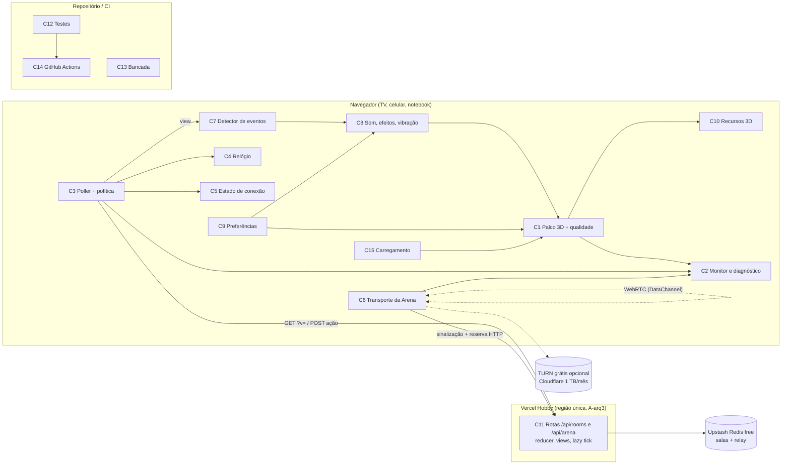

# Plano: Party Deck — menos lag, mais testes e jogo mais vivo

> Gerado por /planejar em 2026-11-09. Revisão: APROVADO COM PENDÊNCIAS. Júri: APROVADO COM CONDIÇÕES (rodada 1)
> Arquivos de trabalho: [análise](01-analise.md) · [arquitetura](02-arquitetura.md) · [design](03-design.md) · [plano](04-plano.md) · [revisão](05-revisao.md) · [júri](06-juri.md) · [custos](custos.md)
> Projeto: repositório `M4DARA-8bit/party-deck` (Next.js 16 + React 19 + three.js/R3F, Vercel Hobby + Upstash Redis gratuito).

## Resumo executivo
O Party Deck (tabuleiro, 13 minigames e Arena em tempo real no navegador) trava em aparelhos comuns: os quadros por segundo caem no 3D e há atraso entre os aparelhos (confirmado em Q1). Além disso, os testes não cobrem telas nem rede. A solução mantém a stack e o custo zero (Q3), sem jogos ou modos novos (Q2). O plano tem quatro frentes:
- qualidade 3D adaptativa e cenas paradas sem redesenho;
- polling por papel de aparelho e região fixa junto do Redis;
- testes de tela, de rede e ponta a ponta, com CI;
- efeitos visuais e sonoros nos eventos dos jogos.

O público são anfitriões e jogadores casuais de festa, no celular e na TV. O esforço é de 125 dias-pessoa mais 19 d de reserva, cerca de 30 semanas para 1 pessoa. O principal risco é o volume de trabalho para uma pessoa (KE4). Logo atrás vem a cota gratuita do Upstash, que limita a latência e as próprias medições (KT5, KT12).

## Objetivos e escopo
- **O1** Fluidez no 3D: no celular de referência (A2), mediana ≥ 50 fps e p95 do tempo de quadro ≤ 33 ms em todo jogo e no tabuleiro.
- **O2** Resposta rápida da sala, medida separadamente por papel de aparelho:
  - p95 ≤ 600 ms na TV e no celular da vez;
  - p95 ≤ 1,2 s nos demais celulares, faixa que depende de Q10.
- **O3** Arena: < 1 % dos retratos com > 100 ms de atraso no mesmo Wi-Fi, e o boneco próprio responde ao joystick no quadro seguinte.
- **O4** Rede de segurança: toda melhoria com teste. Os testes cobrem a rede do cliente e a montagem de cada tela, e lint, typecheck, test e build rodam no CI.
- **O5** Jogo mais vivo: retorno visual e sonoro nos eventos principais de todo minigame e do tabuleiro.

**Dentro:**
- desempenho 3D (todos os jogos, o tabuleiro e a Arena);
- latência das salas e da Arena;
- gráficos e animações de evento;
- áudio nos modos de sala;
- polimento do que já existe: entrada tardia, reconexão, indicadores de conexão;
- testes e medição repetível.

**Fora:**
- jogos, modos ou esportes novos;
- qualquer serviço ou plano pago;
- anticheat;
- contas e ranking global;
- troca de hospedagem;
- app nativo;
- rebalanceamento profundo da Arena.

## Requisitos principais
Só os "Must" (detalhe em [01-analise.md](01-analise.md)):
- **RF1** Qualidade gráfica ajustada automaticamente ao desempenho do aparelho.
- **RF2** Modo "desempenho" manual, persistido no aparelho.
- **RF3** Diagnóstico com fps, tempo de quadro e latência da sala.
- **RF4** Cenas paradas não redesenham o 3D continuamente.
- **RF5** Mudança visível em p95 ≤ 600 ms (TV e celular da vez) e ≤ 1,2 s (demais celulares), sujeito a Q10.
- **RF6** Reconexão sem recarregar a página, com estado "reconectando".
- **RF14** Testes dos módulos de rede do cliente (polling 204/backoff, relógio, transporte da Arena).
- **RF15** Teste de montagem de cada tela de jogo (TV e celular).
- **RF18** Medição e diagnóstico cobrindo as duas frentes de lag, com linha de base antes das mudanças.
- **RF19** Nenhuma entrega adiciona jogo, modo ou esporte.
- RNF centrais:
  - **RNF4**: custo zero, sem aumento de requisições ou comandos Redis por jogador/min, sem IA nem API paga e licenças conferidas;
  - **RNF5**: as views continuam sem vazar dados secretos;
  - **RNF9**: os testes atuais continuam passando.

## Solução
### Arquitetura
A stack fica igual, sem nenhuma dependência nova de execução (D1). Entram só dependências de desenvolvimento (jsdom, Testing Library, `@react-three/test-renderer`, Playwright opcional) e um CI no GitHub Actions (D12).

Decisões-chave (detalhe em [02-arquitetura.md](02-arquitetura.md)):
- **D2** Qualidade adaptativa própria em 3 níveis (dpr, sombra, antisserrilhado), com histerese e nível aprendido por aparelho.
- **D3** `frameloop="demand"` em cenas paradas, com `invalidate()` limitado.
- **D4** Polling dirigido por expectativa de ação e por papel do aparelho (TV, da vez, próximo, demais). Aba oculta não faz requisição.
- **D5** Funções da Vercel na mesma região do Redis, se A-arq3 se confirmar (T73).
- **D6** Eventos de duas fontes: diferença entre views (públicos) e `emitLocal` no controlador (locais).
- **D7/D8** Testes de tela com renderizador simulado, fixtures gerados pelo reducer real, e ponta a ponta pelos handlers das rotas.
- **D9** Relógio por filtro de menor RTT.
- **D10** Arena com serialização única por tick, fila curta e reconexão contínua.
- **D11** Entrada tardia como `status: 'waiting'`, com regras de promoção definidas: conta no limite de 8, começa com 10 moedas, entra no fim de `order[]` e não vota.
- **D13** Cache de recursos 3D, `InstancedMesh` e `useDisposable`.
- **D14** Modo economia e resposta `503 reason:'quota'` com mensagem própria quando a cota acaba.
- **D15** `/bench` existe só com `PD_BENCH=1`, no preview, que usa um banco de medição separado.

### Experiência
**Princípios** (detalhe em [03-design.md](03-design.md)):
- a festa não espera;
- fluidez antes de enfeite;
- funciona sozinho, e quem quiser ajusta;
- dizer o que aconteceu e o que fazer;
- manter o jeito de sempre: tema escuro, tokens de `globals.css`, componentes de `ui.tsx`, estilo low-poly.

**Jornadas:**
- J1: anfitrião monta a festa com TV.
- J2: jogador casual num celular fraco.
- J3: perde a conexão no meio do minigame.
- J4: chega atrasado.
- J5: anfitrião da Arena fecha a tela.
- J6: TV ligada a noite toda.
- J7: grupo reclama de lag e o anfitrião investiga.
- J8: mantenedor mexe num jogo sem medo.

**Jornada de aceitação** (T69, T89): criar sala → entrar pelo QR (com aviso de privacidade) → tabuleiro → minigame → resultado → cair a rede → voltar sem recarregar.

**Mapa de telas:**
- Telas existentes, ampliadas: S1 a S8 e S11.
- Telas e camadas novas:
  - S3: ajustes ⚙;
  - S9: espectador aguardando;
  - S10: diagnóstico;
  - S12: anfitrião saiu;
  - S13: sem WebGL;
  - S14: testes e medição, sem interface.
- Componentes novos: UI1 a UI12, entre eles o chip de conexão, o banner de reconexão, o pop de evento, a transição de fase e o carregamento com progresso.

## Execução
| Fase | Objetivo | Tarefas | Esforço | Marco |
|------|----------|---------|---------|-------|
| F0 Ganhos rápidos | Confirmar região (A-arq3), medir o servidor hoje, baixar dpr/sombra no celular | T73, T7, T8, T75, T76, T74, T39, T77 | 5 d | M0 (semana 1) |
| F1 Base de medição e testes | CI, montagem de amostra de telas, qualidade automática e modo desempenho, diagnóstico, bancada, linha de base, marco de decisão | T78, T1, T79, T2, T6, T3, T4, T5, T17, T18, T19, T72, T81, T80, T9–T16, T82 | 31,5 d | M1b (semana 5) e M1 |
| F2 Desempenho 3D | Montagem de todas as 26 telas, reduzir movimento, sem WebGL, cenas paradas, instâncias, otimização dos jogos piores | T83, T46, T20, T21, T30, T59, T22–T29, T31 | 24 d | M2 |
| F3 Rede, conexão, cota e segurança | Poller e política por papel, reconexão, limite de taxa, cota esgotada, privacidade, `SEGURANCA.md`, cabeçalhos, acessibilidade, Arena | T32–T38, T84, T85, T40–T43, T86, T87, T88, T63, T44 | 26 d | M3 (todos os Must) |
| F4 Polimento de jogo (cortável por KE4) | Ajustes completos, eventos, som, vibração, partículas, transições, efeitos por jogo, entrada tardia, carregamento | T45, T47–T58, T60–T62, T64, T65 | 31 d | M4 |
| F5 Fechamento | Ponta a ponta, longa duração, 4G, compatibilidade, README, teste com jogadores, relatório final | T66–T70, T89, T71 | 7,5 d | M5 |

- **Total:** 125 dias-pessoa em 89 tarefas (T1–T89), mais 19 d de reserva (15 %) e 5 d de arredondamento, somando 149 dias úteis (cerca de 30 semanas para 1 pessoa).
- **Datas:** início em 16/11/2026, M1b em 14/12/2026 e fim previsto em 10/06/2027. Com 2 pessoas, a estimativa fica em cerca de 20 semanas, porque F3 pode rodar em paralelo a F2.
- **Must:** todos se fecham em F0–F3, que somam 86,5 d.
- **Caminho crítico (20,5 d):** T8 → T3 → T4 → T5 → T19 → T46 → T53 → T56 → T57 → T65 → T89 → T71.
- **Gargalos:** a linha de base (T16) e o marco de decisão (T82), o `Stage3D` com qualidade (T19) e a confirmação de região (T73) na semana 1.
- **Controle:** toda sexta há um ponto de controle de 15 min contra o Gantt. É o gatilho de KE4.
- **Detalhe:** a tabela completa de tarefas, com dependências e critérios de aceite, e o Gantt estão em [04-plano.md](04-plano.md).

## Riscos
| Risco | Mitigação |
|-------|-----------|
| K1: efeitos novos pioram o fps | Todo efeito passa pelo nível de qualidade e pela bancada. Medição em F4 (T65) contra T31 |
| K2/KT5/KT12: polling e medições estouram a cota gratuita do Upstash (comandos ou banda de 10 GB) | RNF4 como limite e teste de orçamento (T34). Modo economia (D14) e banco separado para medição (T79). `netbench` local por padrão. Alertas a 60/80 % (T85). Teto de ~15 festas/mês a confirmar em T71 |
| K4/KT3/KE1: renderizador de teste incompatível com React 19/Vitest 5 | Prova de conceito em T2. Plano B: reconciliador nulo, +1 d |
| K5/KE4: esforço de 125 d para 1 pessoa | Reserva de 15 %, gatilho semanal e corte de F4 em ordem definida. Must, T46, T63, T83 e as tarefas de segurança e cota ficam fora do corte |
| K8/KT10/KE2: metas O1–O3 não fecham sem gastar | Linha de base cedo, até 5 d extras por frente e renegociação com números em T71 |
| KE3: região fixa indisponível no plano gratuito | Confirmar em T73 (semana 1). Se não der, a política de polling assume o ganho sozinha |
| KT1/KE8: `frameloop="demand"` congela animações | Migração tela a tela, checklist visual e volta a `active=true` |
| K7/KT6: entrada tardia quebra minigames | Helper `activePlayers` (T59) e testes por minigame antes de mudar |
| KE9: usuário recusa 1,2 s nos celulares fora da vez (Q10) | Testar a variante de 750 ms. Se nem isso bastar, renegociar O2 com RNF4 |
| KE10: limite de taxa bloqueia uma festa no mesmo Wi-Fi | Limites por variável de ambiente e contagem por sala no `join` |

## Premissas e perguntas em aberto
**Premissas:**
- **A1** O lag afeta todos os jogos, e a prioridade sai da linha de base.
- **A2** O aparelho de referência é um Android intermediário de cerca de 3 anos.
- **A3** Só o plano gratuito, com TURN gratuito opcional (Cloudflare).
- **A4** RF9 é polimento.
- **A5** Ainda não existe medição; a linha de base vem primeiro.
- **A6** Dependências de desenvolvimento são aceitas.
- **A7** O estilo low-poly continua.
- **A-arq1** As duas faixas de O2 dependem de Q10.
- **A-arq2** Som: a TV toca os eventos públicos; o celular toca as próprias ações, "sua vez" e vitória/derrota.
- **A-arq3** A região pode ser fixada no plano gratuito.
- **A-arq7** Base legal do apelido: LGPD art. 7º, V, com cuidado especial para menores (art. 14).

**Perguntas** (sem resposta, valem as premissas):
- Q4 (aparelhos do grupo) e Q8 (jogos piores): vão em T78 e orientam T28/T29.
- Q7 (CI e restrições de rede ou proxy): vai em T78.
- Q9 (RF9 é polimento e é prioritário?): vai em T78 e decide T59–T61 (KE7).
- Q10 (faixa de 1,2 s nos celulares fora da vez): vai em T82, com os números medidos.
- Q5 (estilo das animações) e Q6 (onde o som toca): abertas; sem resposta, valem A7 e a tabela de T49.

## Pendências da revisão
- **R12** (baixa, designer, pendente): S3 tem um interruptor "Reduzir animações", e C9/T46 preveem três estados (`system`/`on`/`off`). Decidir ao implementar T45/T46.
- **Contagem de tarefas:** o relato do planejador fala em 84 tarefas, mas a tabela de [04-plano.md](04-plano.md) tem 89 IDs únicos (T1–T89). Este documento usa 89.
- **Design não atualizado depois do júri:** o aviso de privacidade em S1/S2 e o botão "Sair da sala" (T86) só existem na arquitetura e no plano. O 04 registra o conflito e fixa o texto.

## Veredito do júri
**APROVADO COM CONDIÇÕES**, na rodada 1 de no máximo 3.

| Jurado | Voto | Confiança | Válido? | Propostas (bloq./cond./sug.) |
|--------|------|-----------|---------|------------------------------|
| viabilidade | APROVAR COM RESSALVAS | média | sim | 0/3/3 |
| custo | APROVAR COM RESSALVAS | média | sim | 0/3/3 |
| seguranca | APROVAR COM RESSALVAS | média | sim | 0/4/2 |
| valor | APROVAR COM RESSALVAS | média | sim | 0/3/3 |
| diabo | APROVAR COM RESSALVAS | média | sim | 0/4/2 |

**Divergências que continuaram abertas** (detalhe em [06-juri.md](06-juri.md)):
- **D-2** (viabilidade × diabo): viabilidade acha os testes de tela T2–T5 a ordem certa para o maior risco técnico. O diabo diz que gastam cerca de 6 d sem medir lag. O plano limitou T4 a uma amostra (JD5), mas a divergência sobre o valor desses testes continua.
- **D-4** (valor e custo × diabo): o peso de F4 no esforço e se a entrada tardia (RF9) é polimento ou funcionalidade nova. Depende de Q9.
- **D-5** (segurança × custo, viabilidade e diabo): o limite de taxa (JS1) usa a mesma cota do Upstash que os outros querem proteger. Nenhum voto quantificou esse custo; o plano manda documentá-lo no orçamento de cota.
- **D-6** (viabilidade × diabo): reescrever RF5 com duas faixas (JV1) ou medir antes de decidir (JD4). O plano fez os dois: duas faixas em RF5 e confirmação de Q10 com números em T82.
- D-1 (arquivos "ausentes" segundo o jurado de valor) foi esclarecida: os arquivos existem.

**Propostas não aplicadas ou parciais:**
- **JV1** (parcial): O2/RF5 foram reescritos e Q10 foi aberta. O ajuste de T33/T44 depois foi feito pelo planejador.
- **JD1** (parcial): F0, a reserva de 15 % e o gatilho semanal entraram. O corte de T4/T5 para 3 jogos não entrou, porque RF15 é Must.
- **JU5** (sugestão do designer, pendente): aprovar um jogo-piloto de efeitos com 2 pessoas antes de generalizar, e critério de legibilidade em T65.

## Consumo de tokens
- **Total estimado:** cerca de 3,47 milhões de tokens.
  - 2.634.390 contados pelo script;
  - 837.493 de chamadas em segundo plano que o script não registrou, listadas na nota de [custos.md](custos.md).
- **Os 3 maiores consumos:**
  - coordenador: 1.986.911;
  - planejador: cerca de 317 mil, em 3 chamadas;
  - arquiteto: cerca de 250 mil, em 3 chamadas.

## Próximos passos
1. **T73 (dia 1):** conferir no painel da Vercel e do Upstash se dá para fixar a região no plano gratuito, se é possível um segundo banco gratuito e se há alertas de uso.
2. **T8 + T74:** publicar o `Server-Timing` e medir a latência de produção e o fps de 3 cenas antes de qualquer mudança (`?q=legado`).
3. **T76 + T75:** teto de dpr 1,25 e sombra desligada nos celulares, com `?diag=1` mínimo. É o primeiro alívio para quem joga, na semana 1.
4. **T78:** enviar ao dono as perguntas Q4, Q8, Q9 e Q7 (aparelhos, jogos piores, entrada tardia, CI e rede).
5. **T1 + T2:** criar o CI (lint, typecheck, test, build, audit) e a prova de conceito do teste de tela 3D com o Basquete.
